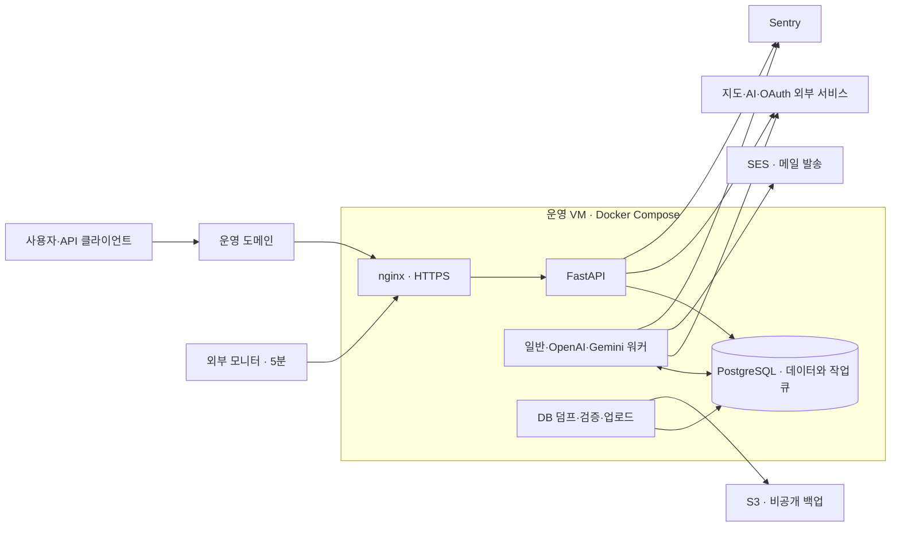

# seelo 운영 인프라 구축 계획

> 2026-10-29 무료 우선 조건 추가: 현재 추천 방향은 [무료 인프라 검토·구축안](seelo_무료인프라_검토_20261029.md)이다. 아래 AWS 유료안은 비용·구성 비교용으로 보존한다.

- 작성: 2026-10-29
- 상태: 실행 계획·서비스 추천안. 실제 계정 개설·결제·서버 생성·배포는 하지 않았다.
- 목표: 백엔드 API·작업·메일·백업·감시를 실제 환경에서 검증하고 소규모 비공개 베타 운영을 준비한다.
- 기준: [백엔드 작업 순서](백엔드_구현계획/12_작업순서.md), [운영 절차](../04_MVP/seelo/infra/OPERATIONS.md), [운영 Compose](../04_MVP/seelo/docker-compose.prod.yml).
- 기존 확인: 백엔드 전체 869개 테스트·로컬 가짜 Compose 검증 완료. 이 결과는 실제 배포·수신·외부 API 검증을 대신하지 않는다.

## 1. 초기 구성안

| 구분 | 추천안 | 이유·조건 |
|---|---|---|
| 서버 | AWS Lightsail 서울, Linux 2 vCPU·4GB RAM·80GB SSD, 공인 IPv4 | 단일 VM에서 기존 Compose 재사용. 초기 용량은 제안이며 실제 부하 시험으로 확정 |
| OS·실행 | 배포 시 지원되는 Ubuntu LTS, Docker Engine·Compose | 현재 Linux 컨테이너 구성 유지 |
| DB·작업 큐 | VM 내부 PostgreSQL 16, 영속 볼륨 | 현재 Procrastinate 큐도 같은 PostgreSQL을 사용 |
| 웹·TLS | nginx, Route 53 DNS, Let's Encrypt·Certbot DNS-01 | nginx 구성을 유지하고 인증서를 웹 서버 기동 전에 발급 |
| 메일 | Amazon SES SMTP, STARTTLS | 기존 SMTP 어댑터 재사용. 발신 도메인 인증·운영 발송 승인 필요 |
| 백업 | 비공개 S3 버킷에 DB 덤프 저장 | VM 손실에 대비한 별도 저장소 |
| 감시 | UptimeRobot 외부 5분 검사, Sentry, 내부 상태 점검 | HTTP 장애와 워커·백업 장애를 각각 감지 |
| 지도 정비 | `AUTO_FIX_ENABLED=false`, `KAKAO_FIX_ENABLED=false` | 관리자 수동 처리로 먼저 운영. 실제 자동 정비 PoC는 별도 |

Lightsail의 해당 IPv4 번들 기본 요금은 월 **24달러**다. 서울 리전 제공 여부와 사양은 공식 문서에서 확인했다. DNS·도메인·S3·메일·API·스냅샷·초과 전송·세금은 별도다. 할인·무료 체험을 총비용 계산의 전제로 삼지 않는다. [공식 번들](https://docs.aws.amazon.com/lightsail/latest/userguide/amazon-lightsail-bundles.html), [제공 리전](https://aws.amazon.com/lightsail/faq/)

구조 선택은 소규모 베타라는 가정에 따른 제안이다. 서버 한 대가 멈추면 API·DB·워커가 함께 중단된다. 초기 복구 목표는 최대 데이터 손실 24시간·서비스 복구 4시간으로 잡고 복구 시험으로 확인한다. 현재 보장된 수치가 아니다.

- 외부 공개는 HTTPS와 HTTP 리디렉션용 443·80이다. SSH는 관리자 접속 원본으로 제한한다.
- DB·API·워커 포트는 VM 밖에 직접 공개하지 않는다.
- 다이어그램의 S3 업로드·워커 오류 수집 연결은 구축·검증 대상이다. 현재 완료된 연결을 뜻하지 않는다.
- React는 이 계획 범위에 포함하지 않는다. API 인수 검증과 실제 사용자 화면 출시를 구분한다.

## 2. 구축 순서와 완료 기준

계정·도메인·키가 준비된 뒤 **3~5작업일**을 목표로 한다(추정). DNS 반영·메일 심사·외부 API 승인 대기와 자동 정비 PoC는 별도다.

| 순서 | 작업 | 산출물·완료 기준 | 선행 조건 |
|---|---|---|---|
| 0 | 계정·도메인·비용 기준 준비 | 운영 계정·도메인 소유 확인, 관리자 수신 주소, 실제 키·모델·일일 호출 비용 상한 목록. SES 도메인 인증·운영 발송 신청 시작 | 계정 접근·실제 서비스 정보 |
| 1 | 배포 전 인프라 코드 보완 | 인증서 배포 훅, S3 백업·복구 연결, 워커·자원·백업 상태 검사, 안전한 배포·이전 이미지 복귀 절차. 로컬 검증 | 현재 저장소 |
| 2 | 서버·DNS·인증서 구성 | VM·영속 저장소·고정 주소, 방화벽·관리자 SSH, DNS 연결, 실제 인증서 발급 및 갱신 시험 | 0·1, 실제 도메인 |
| 3 | 운영 앱·메일·OAuth 배포 | 별도 운영 환경 파일, 이미지 태그·해시, DB·큐 스키마 적용, API·워커 기동, 실제 로그인·메일 수신 | 2, 실제 키·SMTP |
| 4 | 백업·감시 연결 | KST 04시 S3 백업, 새 DB 복구 성공, 외부 5분 감시, API·워커 오류·백업 실패 알림 도착 | 3, S3·감시 계정 |
| 5 | 실제 인수·운영 전환 | 동의한 가게 정상 흐름 2회, 공급자 장애 처리, 부하·복구 결과, 배포 증거 기록 | 4, 지인 가게 동의·연결 |

0번의 외부 신청은 1번과 병행한다. 개발·운영 DB와 비밀 파일은 분리한다. 운영에서는 시연용 `--reset`·`--scenarios`를 실행하지 않는다.

## 3. 서버를 만들기 전에 보완할 코드

기존 설정을 연결하는 것만으로는 끝나지 않는다. 아래는 아직 구현할 작업이다. 파일명은 예정 산출물이며 현재 존재하는 것으로 보지 않는다.

### 3.1 인증서 최초 발급·갱신·nginx 반영

- Route 53 DNS-01로 실제 인증서를 최초 발급한 뒤 운영 web 컨테이너를 시작한다.
- `certbot-dns-route53` 권한은 운영 DNS 영역으로 제한한다. DNS 변경 자격증명은 앱 환경 파일과 분리한다.
- 예정 `infra/scripts/tls_deploy.sh`: 갱신된 인증서·키 검증 → `TLS_CERT_DIR`에 실제 PEM 파일 반영 → nginx 설정 검사 → reload → 외부 HTTPS 확인.
- Certbot의 `live/` 심볼릭 링크만 별도 마운트해 연결이 끊어지지 않게 실제 파일 전달 방식을 고정한다. 디렉터리 마운트를 유지하고 파일 교체 뒤 reload한다.
- 갱신 타이머와 성공 후 deploy hook을 연결한다. 만료 경고는 운영 점검에서도 확인한다.
- 완료: 최초 발급·갱신 dry-run·배포 훅·새 인증서 제공 확인. 재부팅 없이 수행한다.

DNS-01 자동화와 성공 후 갱신 훅은 공식 기능을 사용한다. [Route 53 플러그인](https://certbot-dns-route53.readthedocs.io/en/stable/), [Certbot 갱신·훅](https://eff-certbot.readthedocs.io/en/stable/using.html#renewing-certificates)

### 3.2 S3 백업·복구 연결

- 기존 `backup.sh`는 외부 저장소가 마운트됐다고 가정한다. S3 객체 저장소에 그대로 연결되는 스크립트는 아니다.
- 예정 `infra/scripts/backup_to_s3.sh`: 기존 덤프·목록 검증 재사용 → S3 업로드 → 원격 파일·무결성 확인 → 완료 시각 기록. 로컬 덤프 생성만으로 백업 성공 처리하지 않는다.
- 예정 `infra/scripts/restore_from_s3.sh`: 백업 다운로드·무결성 검사 → 기존 `restore-check.sh`로 **새 DB** 복구. 기존 운영 DB를 덮어쓰지 않는다.
- 버킷 공개 차단·저장 암호화·TLS 전송·백업 쓰기와 복구 접근 권한을 설정한다. 비밀 키는 DB 덤프와 별도로 안전하게 보관한다.
- 매일 KST 04:00 실행하고 실패·최종 성공 시각을 감시한다. 7일 지난 백업은 격리 대상으로 분류하고 자동 영구 삭제하지 않는다. 보관량이 계속 증가할 수 있으므로 용량·비용도 감시한다.
- 완료: 운영 백업을 S3에서 내려받아 새 DB에 복구하고 스키마·주요 행·관계를 확인한다. 별도 복구 시험에서 소요 시간을 기록한다.

S3의 공개 차단과 저장 암호화 상태를 실제 버킷에서 확인한다. [공개 접근 차단](https://docs.aws.amazon.com/AmazonS3/latest/userguide/access-control-block-public-access.html), [저장 암호화](https://docs.aws.amazon.com/AmazonS3/latest/userguide/UsingServerSideEncryption.html)

### 3.3 워커·백업·서버 상태 검사

- 현재 외부 `/api/health` 검사 외에 읽기 전용 운영 점검을 추가한다. API 응답만으로 워커·백업까지 정상이라고 판단하지 않는다.
- 예정 `backend/scripts/check_ops.py`: 워커 생존 정보, 예정 실행 시각이 지난 큐 적체, 최종 원격 백업 성공, 메모리·디스크 상태. 큐의 미래 예약 작업은 적체에서 제외한다.
- 초기 경고 기준 제안: 실행 대기 10분 초과, 백업 성공 후 26시간 초과, 디스크 80% 초과, 메모리 80% 초과가 15분 지속. 실제 시험 결과에 맞춰 조정한다.
- Sentry는 API와 각 워커에서 시험 오류가 실제 수집되는지 확인한다. 필요한 워커 초기화가 빠졌으면 추가한다.
- 외부 HTTP 감시는 UptimeRobot의 5분 검사로 시작한다. 무료 범위에 없는 인증서·타이머 검사 기능은 자체 점검 또는 별도 상품으로 검토하고 무료 제공을 전제하지 않는다.
- 알림은 서비스 SMTP가 고장나도 받을 수 있는 경로로 연결한다. 수신 대상은 운영 준비 때 확정한다.
- 완료: API 오류·워커 중단·백업 실패를 비공개 검증 환경에서 재현해 각각 알림을 받는다.

UptimeRobot의 기본 무료 계획은 5분 검사·HTTP/키워드 감시를 안내한다. 실제 계정에 적용되는 기능을 등록 시 다시 확인한다. [공식 안내](https://help.uptimerobot.com/en/articles/11604710-who-should-use-uptimerobot-s-free-plan)

### 3.4 배포·복귀 절차

- 예정 `infra/scripts/deploy.sh` 또는 운영 절차 확장: `config --quiet` → 배포 전 백업 → 이미지 태그·해시 기록 → DB 변경 적용 → API·워커 순차 교체 → HTTPS·작업·메일 확인.
- 비밀 값이 펼쳐진 Compose 설정·환경 전체를 로그에 출력하지 않는다.
- 실패하면 이전 앱 이미지로 복귀할 수 있게 태그를 보존한다. DB 마이그레이션을 자동으로 되돌리지 않으며 이전 앱과의 호환성을 확인한다.
- worker 종료 대기와 중복 호출 방지 규칙을 유지한다. 실행 중인 작업이 재배포 뒤 중복 결제·중복 메일을 만들지 않는지 확인한다.
- 초기에는 검증된 수동 배포 절차를 쓴다. CI/CD 자동화는 첫 실제 배포·복귀 검증 뒤 별도로 연결한다.

## 4. 실제 환경 연결 사항

| 항목 | 확인할 내용 |
|---|---|
| 운영 비밀 값 | `production.env.example`의 빈 값 채우기. 저장소 밖 파일·접근 제한·별도 복구 보관 |
| Google·카카오 로그인 | 실제 앱 등록, `{APP_BASE_URL}/api/oauth/{provider}/callback` 등록, 로그인·취소·재시도 |
| 지도·AI | 실제 키·API 이용 권한, 측정/추출/정비안 모델 ID, 단가·일일 비용 상한 |
| SES | 도메인·DKIM, SPF·DMARC 구성과 헤더 검사, 전용 SMTP 자격증명·STARTTLS, 운영 발송 승인, 반송·스팸 신고 대응 |
| 실제 가게 | 가게 1~2곳 동의, Google 관리자 초대, 관리자가 직접 정비할 수 있는 권한 |
| 자동 정비 | 초기 비활성화 유지. 관리 화면 PoC·셀렉터·권한 검증 뒤 별도 활성화 |
| 서비스 소개 | 메일·외부 API 신청에 사용할 실제 소개 URL·연락처 준비. 현재 운영 웹 루트는 자리 표시 화면 |

SES 샌드박스에서는 검증된 수신자 등으로 발송이 제한되므로 도메인 인증만으로 운영 발송 완료 처리하지 않는다. SMTP 자격증명은 AWS 로그인·일반 접근 키와 구분한다. [운영 발송 신청](https://docs.aws.amazon.com/ses/latest/dg/request-production-access.html), [SMTP 자격증명](https://docs.aws.amazon.com/ses/latest/dg/send-email-smtp.html)

SES는 발송 수단이다. 운영자·사용자가 회신을 읽을 수 있는 메일함 또는 전달 경로도 별도로 준비한다.

## 5. 최종 인수 조건

- [ ] 실제 도메인의 HTTPS 정상, HTTP→HTTPS, Secure 쿠키, 외부 API 문서 비공개, 토큰 로그 가림.
- [ ] 가입·인증·로그인·비밀번호 재설정과 실제 구글·카카오 로그인.
- [ ] 동의한 가게 진단 → 정비 신청 → 관리자 승인 → 연결 → 정비안 승인 → 관리자 수동 정비 → 재측정 → 보고서·메일을 **2번 연속** 완료.
- [ ] 외부 AI 한 곳 실패 시 나머지 공급자·메일 정상, 측정 실패·보고서 미생성·무료 미차감 확인. 실패 호출을 미노출로 세지 않음.
- [ ] 테스트 가게 5곳의 측정 시간·성공 원문·중복·비용·메모리를 기록. 4GB 용량과 동시 실행 수를 확정.
- [ ] S3 백업→새 DB 복구, 원격 백업 실패·워커 중단·HTTP 장애 알림 수신.
- [ ] 인증서 갱신·nginx 반영, 이전 앱 이미지 복귀 시험.
- [ ] 실제 메일 10종 받은편지함·스팸함과 SPF/DKIM 헤더 확인.

인수는 실제 사용자 유입 전 비공개 검증 기간에 한다. 실제 사용자 운영 중의 장애 주입은 분리 환경으로 옮긴다. 시험 가게·측정·신청·보고서 ID와 시각·실제 비용을 `03_실험/구현시험/`에 기록한다.

관리자의 [지금 재측정]으로 하는 통합 시험과 실제 14일 경과 후 예약 실행 확인은 구분한다. 자연 경과 시험 일정도 정비 완료일 기준으로 따로 기록한다.

## 6. 비용·확장 판단

- 서버 기본 월 24달러에 DNS·도메인·백업·메일·유료 감시·스냅샷·초과 전송·세금·지도/AI 사용량을 더해 예산을 계산한다. 전체 금액은 아직 확정하지 않았다.
- API 사용 비용과 인프라 비용을 따로 추적하고, 일일 API 상한과 월 인프라 예산 알림을 설정한다. 예산 알림을 자동 지출 차단으로 보지 않는다.
- 메모리 부족·실행 대기·측정 시간 기준을 넘으면 먼저 워커 동시 실행 수와 서버 메모리를 조정한다. 서버 증설 비용은 재산정한다.
- 서버 한 대의 장애 영향이 허용되지 않거나 복구·데이터 손실 목표가 엄격해지면 DB 분리·관리형 DB·워커 분리를 검토한다.
- 다중 서버·고가용성·배포 자동화가 필요해지는 시점에 현재 단일 VM 선택을 다시 평가한다.

## 7. 착수 시 필요한 실제 값

1. AWS 계정 접근 가능 여부·운영 도메인·DNS 권한.
2. 운영자 메일함·알림 수신 주소·서비스 소개 URL.
3. 지도·AI·OAuth 키, 사용할 모델과 비용 상한.
4. 실제 검증 가게 동의·관리자 초대.

계정·결제 정보나 비밀 값을 이 문서에 적지 않는다. 이 문서는 계획만 추가하며 기존 `.env`·DB·서버 설정·커밋·푸시는 바꾸지 않는다.
