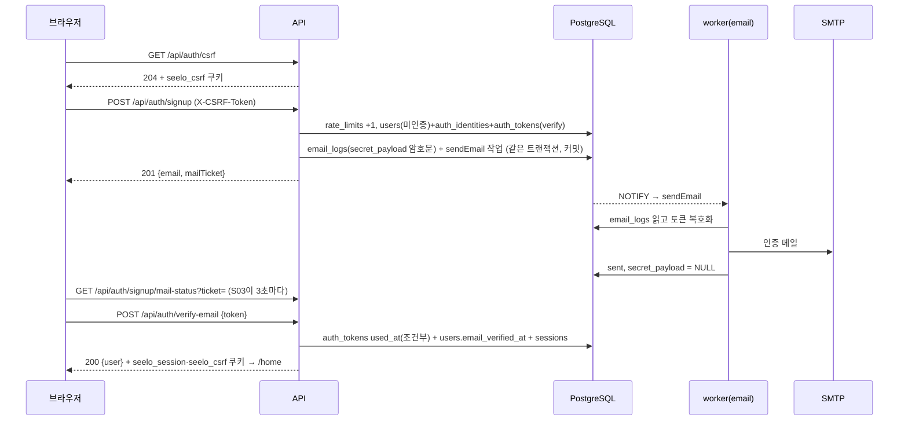
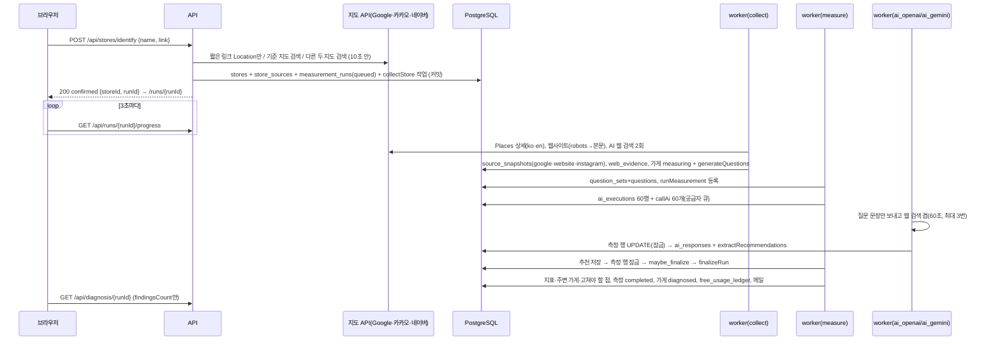
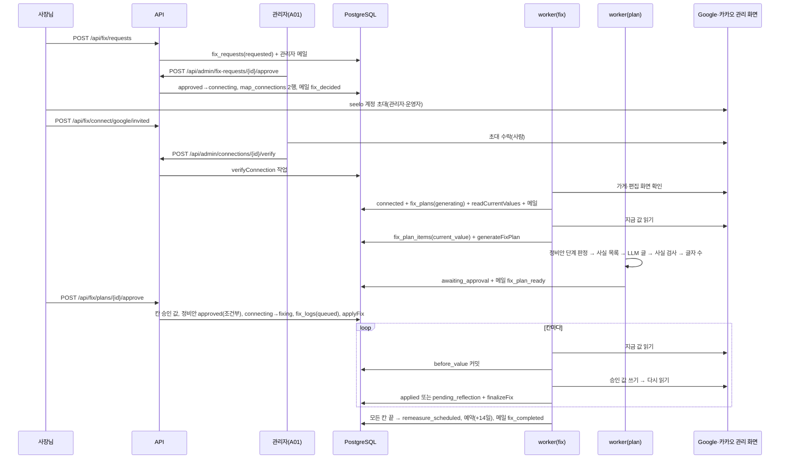
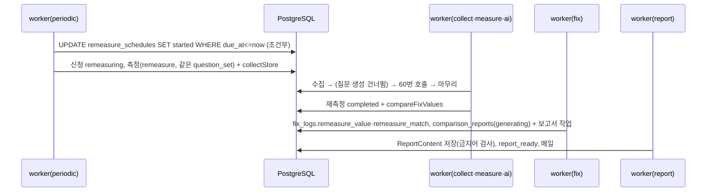

# 15. 흐름도와 예시

- 여기 있는 예시 JSON은 통합 테스트의 기대값으로 그대로 쓴다(값은 예시, 형태가 정답).
- 흐름도의 "같은 트랜잭션" 표시는 06 3장 `jobs.defer` 규칙이다.

## 1. 흐름도

### 1.1 이메일 가입·인증(W-01-2)



### 1.2 가게 등록 → 무료 진단(W-02~W-06)



### 1.3 자동 정비(W-08·W-09, `AUTO_FIX_ENABLED=true`)



### 1.4 재측정·보고서(W-12)



## 2. API 요청·응답 예시

### 2.1 가입 오류

```http
POST /api/auth/signup
X-CSRF-Token: Zx...Q.6f1c...
Content-Type: application/json

{"email": "owner@example.com", "password": "abc", "passwordConfirm": "abd", "agreeTerms": true, "agreePrivacy": false}
```

```json
422
{"error": {"code": "VALIDATION_ERROR", "message": "입력값을 확인해 주세요",
  "details": {"fields": {"password": "weak_password"}}}}
```

- 필드 검사(`weak_password`)에서 실패하면 모델 검사(`password_mismatch`, `terms_required`)는 돌지 않는다(Pydantic 동작). 화면은 받은 필드 코드만 보여 준다.

### 2.2 가게 확정·후보

```json
POST /api/stores/identify
{"name": "명동교자", "link": "[카카오맵] 명동교자 본점\nhttps://kko.to/abc123", "mode": "new"}

200
{"result": "confirmed", "storeId": 12, "runId": 31, "next": "/runs/31"}
```

```json
200
{"result": "candidates", "candidateToken": "q8V...k",
 "candidates": [
   {"candidateId": "naver:0", "name": "명동교자 본점", "address": "서울 중구 명동10길 29", "category": "칼국수,만두", "providers": ["naver"]},
   {"candidateId": "naver:1", "name": "명동교자 분점", "address": "서울 중구 명동길 ...", "category": "칼국수,만두", "providers": ["naver"]}
 ]}
```

### 2.3 진행률

```json
GET /api/runs/31/progress
200
{"runId": 31, "kind": "diagnosis", "status": "running", "stage": "calling_ai",
 "progressDone": 23, "progressTotal": 60, "waitingReason": null, "failureReason": null,
 "canCancel": true, "next": null}
```

### 2.4 무료 진단 결과(일부)

```json
GET /api/diagnosis/31
200
{"runId": 31, "storeId": 12, "storeName": "명동교자", "measuredAt": "2026-11-02T03:15:00Z",
 "providers": {
   "openai": {"successCount": 30, "appearanceCount": 6, "rate": 0.2, "avgRank": 2.3},
   "gemini": {"successCount": 28, "appearanceCount": 0, "rate": 0.0, "avgRank": null}},
 "target": {"name": "명동교자", "providers": {"...": "위와 같음"}},
 "competitors": [{"rankOrder": 1, "name": "Hadongkwan", "providers": {"...": "..."}}],
 "questions": [
   {"orderNo": 1, "lang": "en", "text": "What are good Korean restaurants near Myeong-dong?",
    "textKo": "명동 근처 괜찮은 한식당은?",
    "providers": {"openai": {"appearanceCount": 3, "successCount": 10}, "gemini": null}}],
 "sources": {"top": [{"domain": "tripadvisor.com", "count": 21}], "targetSources": [{"domain": "visitkorea.or.kr", "count": 4}]},
 "findingsCount": 5,
 "conditions": {"questionCount": 3, "repeatCount": 10, "providers": ["openai", "gemini"], "measuredAt": "2026-11-02T03:15:00Z"}}
```

- Gemini 질문 1이 `null` = 그 질문의 Gemini 성공 답변이 0개("측정하지 못함").
- 우리 가게의 영문 이름(예: "Myeongdong Kyoja")이 주변 가게 목록에 나오면 우리 가게 이름 후보에 Google 영문 이름이 빠진 것이다(08 4.2). 이 경우를 테스트 케이스로 둔다: 영문 이름으로만 추천된 응답도 `is_target = true`.

### 2.5 정비안 승인 오류

```json
POST /api/fix/plans/40/approve
{"items": [
  {"itemId": 101, "excluded": false},
  {"itemId": 102, "excluded": false},
  {"itemId": 103, "excluded": true}]}

400
{"error": {"code": "NEEDS_OWNER_INPUT", "message": "\"확인 필요\" 칸을 채우거나 빼 주세요",
  "details": {"itemIds": [102]}}}
```

```json
POST /api/fix/plans/40/approve
{"items": [
  {"itemId": 101, "excluded": false},
  {"itemId": 102, "excluded": false, "approvedValue": "02-776-5348"},
  {"itemId": 103, "excluded": true}]}

202
{"planId": 40, "status": "approved"}
```

### 2.6 남의 데이터

```json
GET /api/fix/plans/40      (다른 사장님 세션)
404
{"error": {"code": "NOT_FOUND", "message": "찾을 수 없어요", "details": {}}}
```

## 3. S07 카드 판정 예(테스트 표)

| 가게 상태 | 최근 신청 | 정비안(최신) | 연결 | 기대 카드 |
|---|---|---|---|---|
| 없음 | — | — | — | `no_store` |
| collecting | 없음 | — | — | `measuring` |
| measure_failed | 없음 | — | — | `measure_failed` |
| diagnosed | 없음 | — | — | `diagnosed` |
| collected | 없음 | — | — | `free_used_store_changed` |
| diagnosed | requested | — | — | `fix_requested` |
| diagnosed | rejected | — | — | `fix_rejected` |
| measuring | approved | — | — | `measuring` |
| measure_failed | approved | — | — | `measure_failed` |
| diagnosed | connecting | 없음 | google invited | `connect_needed` |
| diagnosed | connecting | google generating | google connected | `plan_preparing` |
| diagnosed | connecting | google generation_failed | | `plan_preparing` |
| diagnosed | connecting | google awaiting_approval | | `plan_needs_approval` |
| diagnosed | fixing | google approved, kakao awaiting_approval | | `plan_needs_approval` |
| diagnosed | fixing | google approved | | `fixing` |
| diagnosed | remeasure_scheduled | | | `remeasure_waiting` |
| diagnosed | remeasuring | | | `remeasuring` |
| diagnosed | remeasure_failed | | | `remeasure_failed` |
| diagnosed | report_ready | | | `report_ready` |
| diagnosed | fixing | google approved | google revoked | `fixing` + `revokedProviders=["google"]` |

## 4. 실패 상황별 처리 한눈표

| 상황 | 어디서 | 상태 변화 | 사용자에게 | 관리자에게 |
|---|---|---|---|---|
| 짧은 링크 4번째 이동 | identify | 저장 없음 | 422 `LINK_UNRESOLVED` | — |
| 지도 API 5xx·10초 초과 | identify | 저장 없음 | 503 `TRY_LATER` | Sentry 경고 |
| Google 상세 2번 실패 | collectStore | 스냅샷 failed, 계속 | S10 표에서 Google 열 비움 | 로그 |
| 지역 못 얻음 | collectStore | 측정 failed(collect_insufficient), 가게 measure_failed | S07 측정 실패, 메일 | — |
| 비용 상한 | runMeasurement | waiting_reason, 30분 뒤 재등록 | S10 대기 문구 | 로그 |
| AI 400(설정 오류) | callAi | 실행 failed(bad_request) | — | Sentry |
| 실패율 31% | finalizeRun | 측정 failed, 가게 measure_failed | S07 측정 실패(차감 없음), 메일 | — |
| 워커 강제 종료 | — | 작업 doing으로 남음 | 진행률 멈춤 | `retryStalledJobs`가 다시 실행 |
| 작업이 사라짐 | — | 30분 뒤 측정 failed(stuck) | S07 측정 실패 | 로그 |
| 정비안 LLM 2번 실패 | generateFixPlan | generation_failed | S07 정비안 준비 중 | A01 실패 필터 |
| 로그인 화면 나옴 | applyFix | 남은 칸 manual_required | S13 "seelo 팀 처리 중" | 메일 + 다시 로그인 필요 |
| 저장 버튼 시간 초과 2번 | applyFix | 그 칸 manual_required, 다음 칸 계속 | 같음 | 메일 |
| 사장님이 권한 회수 | 아무 fix 작업 | 연결 revoked, 남은 칸 disconnected | S07 "연결이 끊겼어요" | — |
| 24시간 반영 안 됨 | recheckPendingFixes | manual_required(not_reflected_24h) | S13 "seelo 팀 처리 중" | 메일 |
| 재측정 실패율 31% | finalizeRun | 신청 remeasure_failed | S07 재측정 실패 | — |
| 보고서 2번 실패 | generateComparisonReport | 보고서 generation_failed | S07 재측정 중 유지 | A01 실패 필터 |
| 메일 4번 실패 | sendEmail | email_logs failed | (S03이면 다시 보내기 안내) | 로그 |
