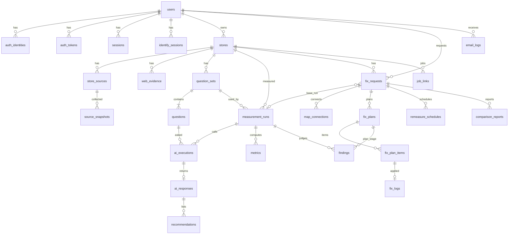

# 02. ERD와 DDL

- 이 파일의 SQL이 **DB의 정답**이다. ORM 모델(`seelo/models/`)은 이 SQL과 정확히 같아야 한다.
- 첫 마이그레이션 `migrations/versions/0001_initial.py`는 `migrations/sql/0001_initial.sql`(4장의 SQL 전체)을 `op.execute()`로 실행한다. 이후 변경은 Alembic 리비전을 새로 만든다.
- `tests/integration/test_schema.py`에서 Alembic `compare_metadata(MigrationContext, Base.metadata)` 결과가 빈 목록인지 확인한다(모델과 DB가 같음). `procrastinate_`로 시작하는 테이블은 비교에서 뺀다.
- API 필드 이름은 컬럼 이름의 camelCase다(`email_verified_at` → `emailVerifiedAt`).

## 1. 명세서 6장 대비 추가·구체화

명세서 6장에 없는 테이블·컬럼과 그 이유다. 여기 있는 항목은 이 문서를 따른다.

| 대상 | 추가·변경 | 이유 |
|---|---|---|
| `pending_signups` 테이블 | 새로 만듦 | 소셜 첫 가입 때 약관 동의(S02)·카카오 이메일 입력(S04)이 끝나기 전까지 계정을 만들지 않기 위해 |
| `identify_sessions` 테이블 | 새로 만듦 | S08→S09 후보 선택 사이에 후보를 들고 있기 위해. 카카오 값은 ID·링크만 둔다 |
| `job_links` 테이블 | 새로 만듦 | 가게 변경·탈퇴 때 진행 중인 Procrastinate 작업을 찾아 취소하기 위해 |
| `users.terms_agreed_at` | 추가 | 약관 동의 시각 |
| `auth_tokens.created_at` | 추가 | 인증 메일 다시 보내기 60초 제한 |
| `source_snapshots.store_id`, `provider`, `status`, `error_code` | 추가 | 출처별 성공·실패 기록(W-03-1·3), `provider` CHECK로 카카오·네이버 저장을 DB에서 막음 |
| `web_evidence.expires_at` | 추가 | 보관 기한(D-10) 삭제 |
| `question_sets.region_ko`, `region_en`, `category`, `features`, `generated_by` | 추가 | 질문을 만든 입력과 방식을 남김(추적성) |
| `questions.text_ko` | 추가 | S11 "영어 질문은 번역도 함께" |
| `measurement_runs.trigger`, `stage`, `waiting_reason`, `failure_reason`, `extraction_failed_count`, `created_at`, `updated_at` | 추가 | 다시 시도 횟수 계산, S10 단계 표시, 비용 상한 대기, 실패 사유, 추출 실패 건수(F-07) |
| `ai_executions.input_tokens`, `output_tokens`, `web_search_calls`, `cost_usd`, `created_at`, `finished_at` | 추가 | 호출마다 비용 기록(W-04-2) |
| `ai_responses.annotated_text`, `extraction_status`, `extraction_json`, `target_claims` | 추가 | 출처 번호를 넣은 원문, 추출 결과·실패 여부, "AI가 틀리게 말함" 판정용 주장 |
| `recommendations.mentioned_attributes` | 추가 | "질문 조건 정보 부족" 판정(주변 가게 추천 이유) |
| `metrics.rank_order`, `display_name`, `created_at` | 추가 | 주변 가게 5곳 순서와 화면 표시 이름 |
| `findings.created_at` | 추가 | — |
| `map_connections.external_ref`, `created_at`, `updated_at` | 추가 | Google `locations/{id}`·카카오 매장 식별값 |
| `fix_plans.generation_attempts`, `last_error` | 추가 | 1회 자동 재시도 판단 |
| `fix_plan_items.order_no` | 추가 | 화면 순서 |
| `fix_logs.fix_request_id`, `last_checked_at`, `created_at`, `updated_at` | 추가 | 정비 완료 판정 조회, 반영 확인 주기 |
| `remeasure_schedules.started_at` | 추가 | `intervalDays` 계산 |
| `comparison_reports.generation_attempts`, `last_error`, `completed_at` | 추가 | 재시도·완료 시각 |
| `email_logs.to_email`, `template_params`, `secret_payload`, `dedupe_key`, `created_at` | 추가 | 발송 재시도, 중복 발송 방지, 메일 링크 토큰 임시 암호화 보관 |
| `audit_logs.detail` | 추가 | 거절 사유 등 |
| 값 형식 | 정비안·정비 기록의 값 컬럼은 `jsonb` | 영업시간·메뉴처럼 구조가 있는 값 |
| 상태 값 | 모든 상태 컬럼은 `text` + `CHECK` | PostgreSQL ENUM은 값 추가 마이그레이션이 번거롭다 |

## 2. ERD



관계 요약
- 사장님(`users`) 1명은 보관 중이 아닌 가게를 1곳만 가진다(부분 고유 인덱스).
- 가게 1곳은 진행 중이거나 끝난 정비 신청을 1건만 가진다(거절 제외, 부분 고유 인덱스).
- 정비 신청 1건은 지도 연결 2행(google·kakao)을 가진다.
- 정비안은 (신청, 지도, 버전)마다 1행이고, 승인된 정비안은 (신청, 지도)마다 1개뿐이다.
- 정비안의 칸 1개는 정비 기록 1행을 가진다(`fix_logs.fix_plan_item_id` 고유 = 덮어쓰기 방지).

## 3. 삭제 규칙

- 탈퇴: `DELETE FROM users WHERE id = :id` 한 문장으로 그 사용자의 모든 행이 지워져야 한다. 그래서 사용자·가게 아래의 외래 키는 `ON DELETE CASCADE`다.
- 다른 사용자(관리자)를 가리키는 컬럼(`decided_by`, `confirmed_by`, `approved_by`, `handled_by`, `audit_logs.actor_id`)은 `ON DELETE SET NULL`이다.
- `free_usage_ledger`는 어떤 테이블도 참조하지 않는다(탈퇴 뒤에도 남는다).
- `measurement_runs.fix_request_id` ↔ `fix_requests.base_run_id`는 서로를 가리키므로 둘 다 `ON DELETE SET NULL`이고, 실제 삭제는 `stores`의 CASCADE로 일어난다.

## 4. DDL(`migrations/sql/0001_initial.sql`)

```sql
-- seelo 0001 initial schema. PostgreSQL 16+
-- 규칙: 모든 시각은 timestamptz(UTC 저장). 상태 값은 text + CHECK.

CREATE OR REPLACE FUNCTION set_updated_at() RETURNS trigger AS $$
BEGIN
  NEW.updated_at = now();
  RETURN NEW;
END;
$$ LANGUAGE plpgsql;

-- 1. 계정 ---------------------------------------------------------------

CREATE TABLE users (
  id                 bigint GENERATED ALWAYS AS IDENTITY PRIMARY KEY,
  email              text NOT NULL UNIQUE,              -- 정규화: strip + lower
  email_verified_at  timestamptz,
  password_hash      text,                              -- Argon2id. 소셜 가입은 NULL
  role               text NOT NULL DEFAULT 'owner' CHECK (role IN ('owner','admin')),
  failed_login_count integer NOT NULL DEFAULT 0 CHECK (failed_login_count >= 0),
  locked_until       timestamptz,
  terms_agreed_at    timestamptz,
  created_at         timestamptz NOT NULL DEFAULT now()
);
CREATE INDEX ix_users_unverified ON users (created_at) WHERE email_verified_at IS NULL;

CREATE TABLE auth_identities (
  id               bigint GENERATED ALWAYS AS IDENTITY PRIMARY KEY,
  user_id          bigint NOT NULL REFERENCES users(id) ON DELETE CASCADE,
  provider         text NOT NULL CHECK (provider IN ('email','google','kakao')),
  provider_user_id text,                                -- google: sub, kakao: 회원번호(문자열), email: NULL
  created_at       timestamptz NOT NULL DEFAULT now(),
  CONSTRAINT uq_identity_user_provider UNIQUE (user_id, provider),
  CONSTRAINT ck_identity_provider_user CHECK ((provider = 'email') = (provider_user_id IS NULL))
);
CREATE UNIQUE INDEX uq_identity_provider_user
  ON auth_identities (provider, provider_user_id) WHERE provider_user_id IS NOT NULL;

CREATE TABLE auth_tokens (
  id         bigint GENERATED ALWAYS AS IDENTITY PRIMARY KEY,
  user_id    bigint NOT NULL REFERENCES users(id) ON DELETE CASCADE,
  type       text NOT NULL CHECK (type IN ('verify','reset')),
  token_hash text NOT NULL UNIQUE,                      -- SHA-256 hex. 원문 저장 금지
  expires_at timestamptz NOT NULL,
  used_at    timestamptz,
  created_at timestamptz NOT NULL DEFAULT now()
);
CREATE INDEX ix_auth_tokens_user_type ON auth_tokens (user_id, type, created_at DESC);

CREATE TABLE sessions (
  id              bigint GENERATED ALWAYS AS IDENTITY PRIMARY KEY,
  user_id         bigint NOT NULL REFERENCES users(id) ON DELETE CASCADE,
  token_hash      text NOT NULL UNIQUE,                 -- SHA-256 hex
  csrf_token_hash text NOT NULL,                        -- SHA-256 hex
  expires_at      timestamptz NOT NULL,
  created_at      timestamptz NOT NULL DEFAULT now(),
  last_seen_at    timestamptz NOT NULL DEFAULT now()
);
CREATE INDEX ix_sessions_user ON sessions (user_id);
CREATE INDEX ix_sessions_expires ON sessions (expires_at);

CREATE TABLE pending_signups (
  id               bigint GENERATED ALWAYS AS IDENTITY PRIMARY KEY,
  provider         text NOT NULL CHECK (provider IN ('google','kakao')),
  provider_user_id text NOT NULL,
  email            text,                                -- 소셜이 준 인증된 이메일. 없으면 NULL(카카오 → S04)
  token_hash       text NOT NULL UNIQUE,                -- 쿠키 pending_signup 값의 SHA-256
  expires_at       timestamptz NOT NULL,                -- 만든 시각 + 30분
  created_at       timestamptz NOT NULL DEFAULT now(),
  CONSTRAINT uq_pending_provider_user UNIQUE (provider, provider_user_id)
);

CREATE TABLE rate_limits (
  key          text NOT NULL,                           -- 예: 'signup:203.0.113.5'
  window_start timestamptz NOT NULL,                    -- 분 단위로 자른 시각
  count        integer NOT NULL DEFAULT 0,
  PRIMARY KEY (key, window_start)
);

CREATE TABLE free_usage_ledger (
  email_hash text PRIMARY KEY,                          -- HMAC-SHA256(EMAIL_HMAC_KEY, 정규화 이메일) hex
  used_at    timestamptz NOT NULL DEFAULT now()
);

-- 2. 가게 ---------------------------------------------------------------

CREATE TABLE identify_sessions (
  id             bigint GENERATED ALWAYS AS IDENTITY PRIMARY KEY,
  user_id        bigint NOT NULL REFERENCES users(id) ON DELETE CASCADE,
  mode           text NOT NULL CHECK (mode IN ('new','change')),
  input_name     text NOT NULL,
  input_url      text NOT NULL,
  input_provider text NOT NULL CHECK (input_provider IN ('google','kakao','naver')),
  candidates     jsonb NOT NULL,                        -- [{candidateId, provider, externalId, url}] 만. 이름·주소 저장 금지
  token_hash     text NOT NULL UNIQUE,                  -- 응답의 candidateToken SHA-256
  expires_at     timestamptz NOT NULL,                  -- + 30분
  created_at     timestamptz NOT NULL DEFAULT now()
);

CREATE TABLE stores (
  id             bigint GENERATED ALWAYS AS IDENTITY PRIMARY KEY,
  owner_id       bigint NOT NULL REFERENCES users(id) ON DELETE CASCADE,
  name           text NOT NULL CHECK (char_length(name) BETWEEN 1 AND 50),   -- 사장님이 입력한 이름
  input_url      text NOT NULL,
  input_provider text NOT NULL CHECK (input_provider IN ('google','kakao','naver')),
  category       text NOT NULL CHECK (category IN ('restaurant','cafe','bar')),
  status         text NOT NULL CHECK (status IN ('collecting','collected','measuring','diagnosed','measure_failed','archived')),
  archived_at    timestamptz,
  created_at     timestamptz NOT NULL DEFAULT now(),
  updated_at     timestamptz NOT NULL DEFAULT now(),
  CONSTRAINT ck_store_archived CHECK ((status = 'archived') = (archived_at IS NOT NULL))
);
CREATE UNIQUE INDEX uq_store_owner_active ON stores (owner_id) WHERE archived_at IS NULL;
CREATE TRIGGER trg_stores_updated BEFORE UPDATE ON stores FOR EACH ROW EXECUTE FUNCTION set_updated_at();

CREATE TABLE store_sources (
  id           bigint GENERATED ALWAYS AS IDENTITY PRIMARY KEY,
  store_id     bigint NOT NULL REFERENCES stores(id) ON DELETE CASCADE,
  provider     text NOT NULL CHECK (provider IN ('google','kakao','naver','website','instagram')),
  external_id  text,                                    -- google: place id, kakao: 장소 번호, naver: 링크의 장소 번호(있을 때), instagram: username
  url          text,
  match_status text NOT NULL CHECK (match_status IN ('found','not_found','candidate')),
  matched_at   timestamptz NOT NULL DEFAULT now(),
  CONSTRAINT uq_store_source UNIQUE (store_id, provider)
);

CREATE TABLE measurement_runs (
  id                      bigint GENERATED ALWAYS AS IDENTITY PRIMARY KEY,
  store_id                bigint NOT NULL REFERENCES stores(id) ON DELETE CASCADE,
  question_set_id         bigint,                       -- FK는 question_sets 생성 뒤 추가
  kind                    text NOT NULL CHECK (kind IN ('diagnosis','remeasure')),
  fix_request_id          bigint,                       -- FK는 fix_requests 생성 뒤 추가
  is_free                 boolean NOT NULL DEFAULT false,
  trigger                 text NOT NULL CHECK (trigger IN ('initial','retry','scheduler','admin')),
  status                  text NOT NULL CHECK (status IN ('queued','running','parsing','completed','failed','canceled')),
  stage                   text NOT NULL DEFAULT 'collecting'
                          CHECK (stage IN ('collecting','generating_questions','calling_ai','finalizing','done')),
  waiting_reason          text CHECK (waiting_reason IN ('cost_limit')),
  failure_reason          text CHECK (failure_reason IN ('failure_rate','collect_insufficient','enqueue_failed','stuck')),
  progress_done           integer NOT NULL DEFAULT 0,
  progress_total          integer NOT NULL DEFAULT 0,
  failure_rate            numeric(5,4),
  extraction_failed_count integer NOT NULL DEFAULT 0,
  cost_usd                numeric(12,6) NOT NULL DEFAULT 0,
  started_at              timestamptz,
  completed_at            timestamptz,
  created_at              timestamptz NOT NULL DEFAULT now(),
  updated_at              timestamptz NOT NULL DEFAULT now(),
  CONSTRAINT ck_run_free_kind CHECK (NOT is_free OR kind = 'diagnosis')
);
CREATE INDEX ix_runs_store_created ON measurement_runs (store_id, created_at DESC);
CREATE INDEX ix_runs_active ON measurement_runs (status) WHERE status IN ('queued','running','parsing');
CREATE TRIGGER trg_runs_updated BEFORE UPDATE ON measurement_runs FOR EACH ROW EXECUTE FUNCTION set_updated_at();

CREATE TABLE source_snapshots (
  id           bigint GENERATED ALWAYS AS IDENTITY PRIMARY KEY,
  source_id    bigint NOT NULL REFERENCES store_sources(id) ON DELETE CASCADE,
  store_id     bigint NOT NULL REFERENCES stores(id) ON DELETE CASCADE,
  run_id       bigint REFERENCES measurement_runs(id) ON DELETE CASCADE,  -- 수집만 한 경우(collected) NULL
  provider     text NOT NULL CHECK (provider IN ('google','website','instagram')),  -- 카카오·네이버 저장 금지
  status       text NOT NULL CHECK (status IN ('ok','failed','robots_disallowed','skipped')),
  error_code   text,
  payload      jsonb,
  collected_at timestamptz NOT NULL DEFAULT now(),
  expires_at   timestamptz NOT NULL
);
CREATE INDEX ix_snapshots_store_provider ON source_snapshots (store_id, provider, collected_at DESC);
CREATE INDEX ix_snapshots_expires ON source_snapshots (expires_at);

CREATE TABLE web_evidence (
  id           bigint GENERATED ALWAYS AS IDENTITY PRIMARY KEY,
  store_id     bigint NOT NULL REFERENCES stores(id) ON DELETE CASCADE,
  run_id       bigint REFERENCES measurement_runs(id) ON DELETE CASCADE,
  provider     text NOT NULL CHECK (provider IN ('openai','gemini')),
  site_url     text NOT NULL,
  site_name    text,
  fields       jsonb NOT NULL,                          -- {name,address,phone,hours,menu[],priceText,instagramUrl}
  collected_at timestamptz NOT NULL DEFAULT now(),
  expires_at   timestamptz NOT NULL
);
CREATE INDEX ix_web_evidence_store ON web_evidence (store_id, collected_at DESC);

-- 3. 질문·측정 -----------------------------------------------------------

CREATE TABLE question_sets (
  id           bigint GENERATED ALWAYS AS IDENTITY PRIMARY KEY,
  store_id     bigint NOT NULL REFERENCES stores(id) ON DELETE CASCADE,
  version      integer NOT NULL,
  region_ko    text NOT NULL,
  region_en    text NOT NULL,
  category     text NOT NULL CHECK (category IN ('restaurant','cafe','bar')),
  features     jsonb NOT NULL DEFAULT '[]',             -- 질문 2에 쓴 조건 키 목록(08 1장)
  generated_by text NOT NULL CHECK (generated_by IN ('llm','template')),
  created_at   timestamptz NOT NULL DEFAULT now(),
  CONSTRAINT uq_question_set_version UNIQUE (store_id, version)
);
ALTER TABLE measurement_runs
  ADD CONSTRAINT fk_runs_question_set FOREIGN KEY (question_set_id) REFERENCES question_sets(id) ON DELETE SET NULL;

CREATE TABLE questions (
  id              bigint GENERATED ALWAYS AS IDENTITY PRIMARY KEY,
  question_set_id bigint NOT NULL REFERENCES question_sets(id) ON DELETE CASCADE,
  order_no        smallint NOT NULL CHECK (order_no BETWEEN 1 AND 3),
  lang            text NOT NULL CHECK (lang IN ('en','ko')),
  intent_type     text NOT NULL CHECK (intent_type IN ('basic','conditional')),
  text            text NOT NULL,
  text_ko         text,                                 -- 영어 질문의 한국어 번역. 한국어 질문은 NULL
  CONSTRAINT uq_question_order UNIQUE (question_set_id, order_no)
);

CREATE TABLE ai_executions (
  id               bigint GENERATED ALWAYS AS IDENTITY PRIMARY KEY,
  run_id           bigint NOT NULL REFERENCES measurement_runs(id) ON DELETE CASCADE,
  question_id      bigint NOT NULL REFERENCES questions(id) ON DELETE CASCADE,
  provider         text NOT NULL CHECK (provider IN ('openai','gemini')),
  model_id         text,
  repeat_no        smallint NOT NULL CHECK (repeat_no >= 1),
  status           text NOT NULL CHECK (status IN ('pending','running','succeeded','failed')),
  attempt          smallint NOT NULL DEFAULT 0,
  latency_ms       integer,
  error_code       text,
  input_tokens     integer,
  output_tokens    integer,
  web_search_calls integer,
  cost_usd         numeric(12,6) NOT NULL DEFAULT 0,
  created_at       timestamptz NOT NULL DEFAULT now(),
  finished_at      timestamptz,
  CONSTRAINT uq_ai_execution UNIQUE (run_id, question_id, provider, repeat_no)
);
CREATE INDEX ix_ai_exec_run_status ON ai_executions (run_id, status);

CREATE TABLE ai_responses (
  id                bigint GENERATED ALWAYS AS IDENTITY PRIMARY KEY,
  execution_id      bigint NOT NULL UNIQUE REFERENCES ai_executions(id) ON DELETE CASCADE,
  raw_text          text NOT NULL,
  raw_json          jsonb NOT NULL,
  source_urls       jsonb NOT NULL DEFAULT '[]',        -- [{n, url, title, domain}]
  annotated_text    text,                               -- 출처 번호 [n]을 넣은 원문(08 3장)
  extraction_status text NOT NULL DEFAULT 'pending' CHECK (extraction_status IN ('pending','succeeded','failed')),
  extraction_json   jsonb,
  target_claims     jsonb,                              -- [{field, value}] 우리 가게에 대한 주장
  created_at        timestamptz NOT NULL DEFAULT now()
);

CREATE TABLE recommendations (
  id                   bigint GENERATED ALWAYS AS IDENTITY PRIMARY KEY,
  response_id          bigint NOT NULL REFERENCES ai_responses(id) ON DELETE CASCADE,
  name                 text NOT NULL,
  normalized_name      text NOT NULL,
  rank                 smallint NOT NULL CHECK (rank >= 1),
  source_urls          jsonb NOT NULL DEFAULT '[]',     -- [{url, domain}]
  mentioned_attributes text[] NOT NULL DEFAULT '{}',    -- 08 0.1의 조건 키
  is_target            boolean NOT NULL DEFAULT false
);
CREATE INDEX ix_recommendations_response ON recommendations (response_id);
CREATE INDEX ix_recommendations_name ON recommendations (normalized_name);

CREATE TABLE metrics (
  id           bigint GENERATED ALWAYS AS IDENTITY PRIMARY KEY,
  run_id       bigint NOT NULL REFERENCES measurement_runs(id) ON DELETE CASCADE,
  provider     text NOT NULL CHECK (provider IN ('openai','gemini')),
  question_id  bigint REFERENCES questions(id) ON DELETE CASCADE,   -- NULL = 질문 전체
  subject_type text NOT NULL CHECK (subject_type IN ('target','competitor','source')),
  subject_name text NOT NULL,                           -- target: 'target', competitor: 정규화 이름, source: 도메인
  metric_name  text NOT NULL CHECK (metric_name IN (
                 'success_count','appearance_count','appearance_rate','avg_rank',
                 'citation_count','target_citation_count')),
  value        numeric,                                 -- NULL = 계산 불가(측정하지 못함·등장 없음)
  denominator  integer,
  rank_order   smallint,                                -- competitor: 1~5 순서
  display_name text,                                    -- competitor: 화면에 보일 원래 이름
  created_at   timestamptz NOT NULL DEFAULT now()
);
CREATE INDEX ix_metrics_run ON metrics (run_id, subject_type, provider);

-- 4. 정비 ---------------------------------------------------------------

CREATE TABLE fix_requests (
  id               bigint GENERATED ALWAYS AS IDENTITY PRIMARY KEY,
  user_id          bigint NOT NULL REFERENCES users(id) ON DELETE CASCADE,
  store_id         bigint NOT NULL REFERENCES stores(id) ON DELETE CASCADE,
  base_run_id      bigint REFERENCES measurement_runs(id) ON DELETE SET NULL,
  status           text NOT NULL CHECK (status IN ('requested','approved','connecting','fixing',
                     'remeasure_scheduled','remeasuring','remeasure_failed','report_ready','rejected')),
  reject_reason    text,
  decided_by       bigint REFERENCES users(id) ON DELETE SET NULL,
  decided_at       timestamptz,
  fix_completed_at timestamptz,
  created_at       timestamptz NOT NULL DEFAULT now(),
  updated_at       timestamptz NOT NULL DEFAULT now(),
  CONSTRAINT ck_fix_request_reject CHECK (status <> 'rejected' OR reject_reason IS NOT NULL)
);
CREATE UNIQUE INDEX uq_fix_request_store_active ON fix_requests (store_id) WHERE status <> 'rejected';
CREATE TRIGGER trg_fix_requests_updated BEFORE UPDATE ON fix_requests FOR EACH ROW EXECUTE FUNCTION set_updated_at();
ALTER TABLE measurement_runs
  ADD CONSTRAINT fk_runs_fix_request FOREIGN KEY (fix_request_id) REFERENCES fix_requests(id) ON DELETE SET NULL;

CREATE TABLE findings (
  id               bigint GENERATED ALWAYS AS IDENTITY PRIMARY KEY,
  run_id           bigint NOT NULL REFERENCES measurement_runs(id) ON DELETE CASCADE,
  fix_plan_id      bigint,                              -- FK는 fix_plans 생성 뒤 추가
  stage            text NOT NULL CHECK (stage IN ('diagnosis','plan')),
  category         text NOT NULL CHECK (category IN ('map_missing','source_mismatch','english_missing','condition_missing','ai_wrong')),
  title_key        text NOT NULL,                       -- 08 6.7 제목 키
  provider         text NOT NULL CHECK (provider IN ('google','kakao')),
  field            text NOT NULL,                       -- 09 3장 칸 키 또는 name·address·category·listing
  competitor_count integer NOT NULL DEFAULT 0,
  question_count   integer NOT NULL DEFAULT 0,
  priority         integer NOT NULL DEFAULT 0,          -- 1부터. 작을수록 먼저
  evidence         jsonb NOT NULL DEFAULT '{}',
  created_at       timestamptz NOT NULL DEFAULT now()
);
CREATE INDEX ix_findings_run_stage ON findings (run_id, stage);

CREATE TABLE map_connections (
  id                      bigint GENERATED ALWAYS AS IDENTITY PRIMARY KEY,
  fix_request_id          bigint NOT NULL REFERENCES fix_requests(id) ON DELETE CASCADE,
  provider                text NOT NULL CHECK (provider IN ('google','kakao')),
  status                  text NOT NULL CHECK (status IN ('not_connected','invited','connected','needs_attention','revoked')),
  attention_reason        text CHECK (attention_reason IN ('verification_required','under_review','duplicate_profile',
                            'no_owner_authority','guideline_violation','store_not_visible','other')),
  external_ref            text,                         -- google: 'locations/123', kakao: 파트너센터 매장 식별값
  invited_at              timestamptz,
  invite_reminder_sent_at timestamptz,
  connected_at            timestamptz,
  confirmed_by            bigint REFERENCES users(id) ON DELETE SET NULL,
  revoked_at              timestamptz,
  created_at              timestamptz NOT NULL DEFAULT now(),
  updated_at              timestamptz NOT NULL DEFAULT now(),
  CONSTRAINT uq_connection UNIQUE (fix_request_id, provider)
);
CREATE TRIGGER trg_connections_updated BEFORE UPDATE ON map_connections FOR EACH ROW EXECUTE FUNCTION set_updated_at();

CREATE TABLE fix_plans (
  id                  bigint GENERATED ALWAYS AS IDENTITY PRIMARY KEY,
  fix_request_id      bigint NOT NULL REFERENCES fix_requests(id) ON DELETE CASCADE,
  provider            text NOT NULL CHECK (provider IN ('google','kakao')),
  base_run_id         bigint REFERENCES measurement_runs(id) ON DELETE SET NULL,
  version             integer NOT NULL,
  status              text NOT NULL CHECK (status IN ('generating','generation_failed','awaiting_approval','approved')),
  generation_attempts smallint NOT NULL DEFAULT 0,
  last_error          text,
  created_at          timestamptz NOT NULL DEFAULT now(),
  approved_at         timestamptz,
  approved_by         bigint REFERENCES users(id) ON DELETE SET NULL,
  CONSTRAINT uq_fix_plan_version UNIQUE (fix_request_id, provider, version)
);
CREATE UNIQUE INDEX uq_fix_plan_approved ON fix_plans (fix_request_id, provider) WHERE status = 'approved';
ALTER TABLE findings
  ADD CONSTRAINT fk_findings_fix_plan FOREIGN KEY (fix_plan_id) REFERENCES fix_plans(id) ON DELETE CASCADE;

CREATE TABLE fix_plan_items (
  id                bigint GENERATED ALWAYS AS IDENTITY PRIMARY KEY,
  fix_plan_id       bigint NOT NULL REFERENCES fix_plans(id) ON DELETE CASCADE,
  order_no          integer NOT NULL,
  field             text NOT NULL,                      -- 09 3장 칸 키
  current_value     jsonb,                              -- 연결 뒤 읽은 지금 값
  proposed_value    jsonb,                              -- seelo가 만든 바꿀 값
  approved_value    jsonb,                              -- 사장님이 승인한 값
  reason            text,
  finding_ids       bigint[] NOT NULL DEFAULT '{}',
  evidence          jsonb NOT NULL DEFAULT '{}',
  needs_owner_input boolean NOT NULL DEFAULT false,
  sensitive         boolean NOT NULL DEFAULT false,
  owner_confirmed   boolean NOT NULL DEFAULT false,
  owner_edited      boolean NOT NULL DEFAULT false,
  excluded          boolean NOT NULL DEFAULT false,
  CONSTRAINT uq_plan_item_field UNIQUE (fix_plan_id, field),
  CONSTRAINT ck_plan_item_forbidden CHECK (field NOT IN ('name','address','category','listing'))
);

CREATE TABLE fix_logs (
  id               bigint GENERATED ALWAYS AS IDENTITY PRIMARY KEY,
  fix_plan_item_id bigint NOT NULL UNIQUE REFERENCES fix_plan_items(id) ON DELETE CASCADE,
  fix_request_id   bigint NOT NULL REFERENCES fix_requests(id) ON DELETE CASCADE,
  provider         text NOT NULL CHECK (provider IN ('google','kakao')),
  field            text NOT NULL,
  method           text NOT NULL CHECK (method IN ('browser','api','manual')),
  before_value     jsonb,
  applied_value    jsonb NOT NULL,                      -- = 승인 값
  status           text NOT NULL CHECK (status IN ('queued','applied','pending_reflection','manual_required','manual_done','disconnected')),
  attempt          smallint NOT NULL DEFAULT 0,
  error_code       text,
  manual_reason    text CHECK (manual_reason IN ('automation_blocked','write_failed','not_reflected_24h','kakao_fix_disabled',
                     'api_unsupported','automation_disabled')),
  applied_at       timestamptz,
  verified_at      timestamptz,
  verify_count     smallint NOT NULL DEFAULT 0,
  last_checked_at  timestamptz,
  handled_by       bigint REFERENCES users(id) ON DELETE SET NULL,
  handled_at       timestamptz,
  remeasure_value  jsonb,
  remeasure_match  text CHECK (remeasure_match IN ('match','differs','unknown')),
  created_at       timestamptz NOT NULL DEFAULT now(),
  updated_at       timestamptz NOT NULL DEFAULT now()
);
CREATE INDEX ix_fix_logs_request ON fix_logs (fix_request_id);
CREATE INDEX ix_fix_logs_open ON fix_logs (status) WHERE status IN ('queued','pending_reflection','manual_required');
CREATE TRIGGER trg_fix_logs_updated BEFORE UPDATE ON fix_logs FOR EACH ROW EXECUTE FUNCTION set_updated_at();

CREATE TABLE remeasure_schedules (
  id             bigint GENERATED ALWAYS AS IDENTITY PRIMARY KEY,
  fix_request_id bigint NOT NULL REFERENCES fix_requests(id) ON DELETE CASCADE,
  due_at         timestamptz NOT NULL,
  triggered_by   text NOT NULL CHECK (triggered_by IN ('scheduler','admin')),
  status         text NOT NULL CHECK (status IN ('scheduled','started','canceled')),
  run_id         bigint REFERENCES measurement_runs(id) ON DELETE SET NULL,
  started_at     timestamptz,
  created_at     timestamptz NOT NULL DEFAULT now()
);
CREATE UNIQUE INDEX uq_remeasure_active ON remeasure_schedules (fix_request_id) WHERE status = 'scheduled';
CREATE INDEX ix_remeasure_due ON remeasure_schedules (due_at) WHERE status = 'scheduled';

CREATE TABLE comparison_reports (
  id                  bigint GENERATED ALWAYS AS IDENTITY PRIMARY KEY,
  fix_request_id      bigint NOT NULL REFERENCES fix_requests(id) ON DELETE CASCADE,
  store_id            bigint NOT NULL REFERENCES stores(id) ON DELETE CASCADE,
  base_run_id         bigint REFERENCES measurement_runs(id) ON DELETE SET NULL,
  after_run_id        bigint REFERENCES measurement_runs(id) ON DELETE SET NULL,
  interval_days       integer,
  version             integer NOT NULL,
  status              text NOT NULL CHECK (status IN ('generating','completed','generation_failed')),
  generation_attempts smallint NOT NULL DEFAULT 0,
  last_error          text,
  content             jsonb,                            -- 10 3장 스키마
  created_at          timestamptz NOT NULL DEFAULT now(),
  completed_at        timestamptz,
  CONSTRAINT uq_report_version UNIQUE (fix_request_id, version)
);

-- 5. 운영 ---------------------------------------------------------------

CREATE TABLE email_logs (
  id              bigint GENERATED ALWAYS AS IDENTITY PRIMARY KEY,
  user_id         bigint REFERENCES users(id) ON DELETE CASCADE,  -- 관리자 알림은 NULL
  type            text NOT NULL CHECK (type IN ('verify_email','password_reset','diagnosis_result','fix_requested',
                    'fix_decided','map_connection','fix_plan_ready','manual_required','fix_completed','report_ready')),
  to_email        text NOT NULL,                        -- 여러 주소면 쉼표로
  template_params jsonb NOT NULL DEFAULT '{}',          -- 비밀 아닌 값만
  secret_payload  bytea,                                -- Fernet 암호문(메일 링크 토큰). 발송 끝나면 NULL
  dedupe_key      text UNIQUE,                          -- 같은 사건 중복 발송 방지
  status          text NOT NULL CHECK (status IN ('queued','sent','failed')),
  attempt         smallint NOT NULL DEFAULT 0,
  sent_at         timestamptz,
  error           text,
  created_at      timestamptz NOT NULL DEFAULT now()
);

CREATE TABLE audit_logs (
  id          bigint GENERATED ALWAYS AS IDENTITY PRIMARY KEY,
  actor_id    bigint REFERENCES users(id) ON DELETE SET NULL,
  action      text NOT NULL,                            -- 03 6장 목록
  target_type text NOT NULL,
  target_id   bigint,
  detail      jsonb NOT NULL DEFAULT '{}',              -- 개인정보·비밀 값 금지
  created_at  timestamptz NOT NULL DEFAULT now()
);
CREATE INDEX ix_audit_target ON audit_logs (target_type, target_id);

CREATE TABLE job_links (
  id                   bigint GENERATED ALWAYS AS IDENTITY PRIMARY KEY,
  procrastinate_job_id bigint NOT NULL,
  task_name            text NOT NULL,
  store_id             bigint REFERENCES stores(id) ON DELETE CASCADE,
  run_id               bigint REFERENCES measurement_runs(id) ON DELETE CASCADE,
  fix_request_id       bigint REFERENCES fix_requests(id) ON DELETE CASCADE,
  created_at           timestamptz NOT NULL DEFAULT now()
);
CREATE INDEX ix_job_links_store ON job_links (store_id);
CREATE INDEX ix_job_links_run ON job_links (run_id);
CREATE INDEX ix_job_links_request ON job_links (fix_request_id);
```

## 5. ORM 작성 규칙

- 파일 배치는 01 2장. 클래스 이름은 테이블 이름의 단수 PascalCase(`users` → `User`, `fix_plan_items` → `FixPlanItem`, `free_usage_ledger` → `FreeUsageLedger`).
- 상태·종류 컬럼은 `Mapped[str]` + `CheckConstraint`(위와 같은 이름). 파이썬 쪽 허용 값은 `domain/states.py`의 `StrEnum`으로 한 번만 정의하고, CHECK 문자열과 같아야 한다(테스트로 확인: 각 Enum 값 집합 == DDL CHECK 값 집합).
- `jsonb` → `sqlalchemy.dialects.postgresql.JSONB`, `text[]` → `ARRAY(Text)`, `bigint[]` → `ARRAY(BigInteger)`, `bytea` → `LargeBinary`.
- 부분 인덱스·트리거는 마이그레이션 SQL에만 있어도 되지만, 부분 인덱스는 `Index(..., postgresql_where=...)`로 모델에도 적는다(비교 테스트를 통과시키기 위해).
- `updated_at`은 DB 트리거가 갱신한다. 코드에서 직접 넣지 않는다.

## 6. 데이터 보관과 정리

| 데이터 | 보관 | 정리 작업 |
|---|---|---|
| `source_snapshots`, `web_evidence` | `expires_at = collected_at + SNAPSHOT_RETENTION_DAYS`(D-10) | `purgeSnapshots` 매일 |
| `sessions` | `expires_at`까지 | `cleanupUnverified`(매시간)가 만료 행도 지움 |
| `pending_signups`, `identify_sessions` | 30분 | `cleanupUnverified` |
| `rate_limits` | 1시간 지난 창 | `cleanupUnverified` |
| 미인증 `users` | 가입 후 24시간 | `cleanupUnverified` |
| `auth_tokens` | 사용·만료 뒤 7일 | `cleanupUnverified` |
| `email_logs.secret_payload` | 발송 성공·최종 실패 즉시 NULL | `sendEmail` |
| 끝난 Procrastinate 작업 행 | 7일 | `purgeSnapshots`에서 함께 정리(06 5장) |
| 그 밖(측정·정비·보고서) | 탈퇴할 때까지 | — |
