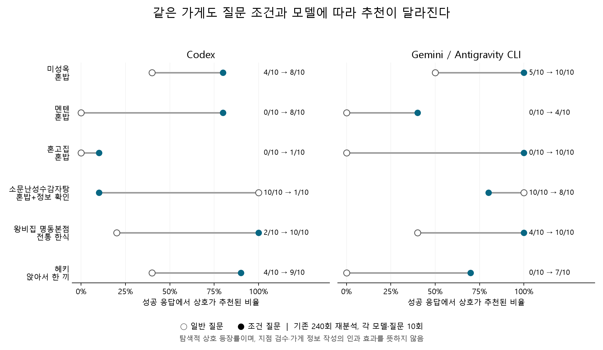

# GEO 조건별 추천 연구 결과

**핵심 관찰: 같은 식당의 추천은 질문 조건과 모델에 따라 크게 달라진다. 업종·키워드 수만으로 설명하기 어렵다.**
정보 작성이 추천을 늘리는 원인인지는 아직 검증되지 않았다. 이번에는 추천에 들어간 식당, 조건에 연결된 증거, 실제 검색 질의와 출처를 나눠 분석했다.

## 1. 반복 관찰에서 확인한 조건별 변화

기존 한국어 CLI 240회, 1,200개 추천을 재분석했다. 아래의 각 셀은 **같은 지역·모델의 질문 10회 중 상호 등장 횟수**다. 두 모델 합계는 질문당 20회다. 식당 이름은 기존 정규화 체계를 사용했으며 지점 전수 재검수 결과가 아니다.

| 상호 | 바뀐 질문 조건 | Codex 일반→조건 | Gemini CLI 일반→조건 | 합계 일반→조건 |
|---|---|---:|---:|---:|
| 미성옥 | 혼밥 | 4/10 → 8/10 | 5/10 → 10/10 | 9/20 → 18/20 |
| 멘텐 | 혼밥 | 0/10 → 8/10 | 0/10 → 4/10 | 0/20 → 12/20 |
| 혼고집 | 혼밥 | 0/10 → 1/10 | 0/10 → 10/10 | 0/20 → 11/20 |
| 소문난성수감자탕 | 혼밥+정보 확인 | 10/10 → 1/10 | 10/10 → 8/10 | 20/20 → 9/20 |
| 왕비집 명동본점 | 전통 한식 | 2/10 → 10/10 | 4/10 → 10/10 | 6/20 → 20/20 |
| 헤키 | 앉아서 한 끼 | 4/10 → 9/10 | 0/10 → 7/10 | 4/20 → 16/20 |



- **두 모델에서 같은 방향**: 미성옥·멘텐은 혼밥, 왕비집은 전통 한식, 헤키는 앉아서 식사 조건에서 증가했다. 공통 조건 반응 후보로 남겼다.
- **모델에 따라 차이**: 혼고집 증가는 Codex 0→1회, Gemini 0→10회다. 이를 보편적인 혼밥 노출 효과로 합쳐 설명하면 안 된다. 성수 텐동식당·헤비스테이크도 일반→혼밥 증가가 Gemini에 집중됐다.
- **일반 인기와 조건 적합성이 다름**: 소문난성수감자탕은 일반 질문 양쪽 10/10이지만 혼밥+정보 확인 질문에서는 Codex 1/10, Gemini 8/10이다.
- **음식 분류는 충분한 설명 변수가 아님**: 원래 30곳의 외부 메뉴군을 지역별로 나눠도 같은 메뉴군 안에서 변화가 다르다. 전체 업종을 1인 주문·좌석·최소 주문 같은 실제 조건으로 대체하지 않는다. 소규모 메뉴군 집계는 `legacy_category_intent_associations.csv`에 별도 보존했다.

## 2. AI가 설명하는 이유도 질문에 따라 바뀐다

명동 추천 100개씩에서 혼밥/1인 좌석 관련 문자열을 포함한 이유는 일반 질문 11개에서 혼밥 질문 87개로 늘었다. 노포·전통 표현은 39→11개, 미쉐린 등 수상 표현은 17→2개로 줄었다. **이는 모델이 쓴 설명의 변화이며, 실제 좌석이나 선정 원인이 확인됐다는 뜻은 아니다.** 태그 규칙과 문장은 `legacy_reason_claim_tags.csv`에 보존했다.

## 3. 새 8조건 자연 검색 관찰

명동·성수·망원 × 8조건 × 2CLI × 2회 = 96셀을 고정하고 실행했다. 세 지도 정보를 우선하되 접근 실패 시 공개 웹 자료를 허용했다. 이는 기존 지도 전용 접근 파일럿과 다른 출처 정책이다. 모델에 후보명이나 수집 자료를 주지 않았다.

- 현재 실행 상태: **78시도**, 고유 셀 상태 {"completed": 59, "tool_permission_denied": 15, "timeout": 4, "not_attempted": 18}.
- 추천 항목 122개, 출처 표기 141건, 그중 도메인 첫 화면 URL만 제시한 표기 76건. 인용 수는 독립 출처 수가 아니다.
- 기술 실패·권한 거부는 가게 미노출 0으로 계산하지 않았다. 성공 응답의 빈 추천은 조건 검증 부족에 의한 유보로 별도 집계했다.
- 조건별 성공 수와 지역 구성이 다를 수 있으므로 아래 전체 평균만으로 가게 효과를 비교하지 않는다. 각 지역·모델의 2회 반복은 확증 분석에 부족하다.

| 조건 | Codex 성공/계획 · 추천 수 | Gemini CLI 성공/계획 · 추천 수 |
|---|---:|---:|
| 일반 | 4/6 · 11개 | 5/6 · 17개 |
| 혼밥 | 4/6 · 6개 | 4/6 · 12개 |
| 1만 원 이하 | 6/6 · 5개 | 6/6 · 22개 |
| 성인 6인 한 테이블 | 2/6 · 4개 | 2/6 · 8개 |
| 만 5세 아이 동반 | 2/6 · 0개 | 3/6 · 9개 |
| 전용·제휴 주차 | 5/6 · 2개 | 3/6 · 6개 |
| 좌석 사전 예약 | 4/6 · 7개 | 2/6 · 4개 |
| 비건 식사 | 5/6 · 4개 | 2/6 · 5개 |

조건 추천에서 모델이 스스로 confirmed라고 쓴 항목은 Codex 6/28, Gemini CLI 56/66다. **연구자가 사실 검증을 끝낸 비율이 아니다.** 같은 질문이라도 검증을 보수적으로 처리하는 정도가 다르므로 추천 수가 많은 모델을 더 정확하다고 평가하지 않는다.

## 4. GEO 특징 47개로 세분화

세부 정의는 `geo_feature_codebook.csv`에 저장했다. 이름·출처 검수와 조건 사실을 독립 수집하고, 생성된 추천 이유와 분리한다.

| 조건 | 우선 수집할 사실 | 혼동하면 안 되는 정보 |
|---|---|---|
| 혼밥 | 1인 주문, 최소 인원, 바·1인석, 혼밥 시간 제한 | 국수·돈가스라는 업종만으로 혼밥 확정 |
| 예산 | 식사 메뉴, 필수 추가비, 최소 주문, 1인 식사 총액 | 음료·곁들임·100g 단가를 식사 비용으로 사용 |
| 단체 | 6명 한 테이블, 룸, 단체 인원 범위, 예약 조건 | 매장 전체 80석을 6인 테이블로 해석 |
| 아이 동반 | 입장 허용, 덜 매운 식사, 유아 의자, 유모차·엘리베이터 | 가족 키워드가 있다는 이유만으로 시설 확정 |
| 주차 | 전용·제휴 여부, 대수, 지원 시간·요금 | 근처 공영주차장을 식당 제휴로 해석 |
| 예약 | 좌석 사전 예약, 실제 채널, 인원·시간 제한 | 대기 등록·전화번호·예약 버튼 존재만으로 확정 |
| 비건 | 비건 식사 메뉴, 육수·소스, 변경 주문 조건 | 채소 메뉴·샐러드만 보고 비건 확정 |
| 증거 | 작성 주체, 날짜, 숫자와 적용 범위, 상충 정보 | 플랫폼 AI 요약이나 사업자 인증을 업주 소개로 해석 |

기존 카카오 독립 후보 60곳에 47개 특징 스키마를 적용해 **2,820행**으로 전처리했다. 새 조건의 시설·재료 정보 대부분은 미수집이다. 결측을 없음으로 바꾸거나 AI 추천 이유에서 채우지 않았다. 메뉴 텍스트·가격이 관측된 57곳도 1인 총 식사비가 확인된 57곳이라는 뜻은 아니다.

가격 조건의 중요한 검수 사례: 육통령의 처음 두 메뉴는 48,000원·38,000원이었지만 뒤쪽에 15,000원 비빔밥과 8,000원 김치찌개가 보였다. 김치찌개에는 공기밥 별도 조건이 있어 8,000원을 한 끼 총액으로 확정할 수 없다. 관측한 57곳 중 23곳은 처음 두 메뉴에 뒤쪽의 더 낮은 가격이 빠져 있었다. 부분 메뉴 추출은 AI의 예산 판단을 왜곡할 수 있으며, 이것만으로 실제 추천 증가 효과가 증명된 것은 아니다.

## 5. 인용 내용 직접 점검

목적표집한 4개 출처를 다시 열어 확인했다. 오류율 추정 표본은 아니다. `manual_source_audit.json`에 판정 근거를 보존했다.

- [코스모스상점 서울관광 안내](https://english.visitseoul.net/restaurants/CosmosgrocerySeongsu/ENPstf3z3)는 비건 브런치와 식사 메뉴를 실제로 설명한다. 다만 모든 소스·육수의 성분표를 확인한 것은 아니다.
- [비건 키친 서울관광 안내](https://english.visitseoul.net/area/VeganKitchen/ENP4uv0kz)는 비건 식당으로 소개하지만 일부 메뉴 명칭의 재료 범위는 불명확하다. 추정으로 해결하지 않았다.
- [딘타이펑 홈페이지](https://www.dintaifung.co.kr/)만으로 모델이 주장한 명동 지점 유아 의자를 확인하지 못했다. 이 시설이 없다는 판정과 다르다.
- [왕비집 명동중앙점 페이지](https://wangbijib-myeongdong.orwst.com/ko)의 예약 링크 존재와 실제 예약 가능은 다르다. 중앙점과 과거 본점 등장률을 같은 가게로 합치지 않는다.

## 6. 현재 검증할 가치가 있는 가설

1. **조건과 직접 연결되는 구체적 사실**이 있는 가게는 해당 조건 질문에서 더 자주 추천될 수 있다. 혼밥·인원·예산처럼 서로 다른 조건의 정보를 구분해 검증한다.
2. **적용 범위까지 적힌 증거**가 단순 가능 표기보다 모델의 조건 확신과 추천 포함에 영향을 줄 수 있다. 현재는 가설이며, 같은 사실을 유지한 표현 통제가 필요하다.
3. **AI가 실제 검색한 출처에서 확인되는지**가 지도에 작성한 내용 자체보다 먼저 작용할 수 있다. 검색 노출→조건 증거 확인→최종 추천→인용을 별도 결과로 둔다.
4. **브랜드 기억과 모델별 출처 선택**이 조건 적합성 효과와 섞일 수 있다. 동일 사실의 실명/익명 비교와 모델별 분석으로 분리해야 한다.

현재 자료만으로 “이 문장을 지도에 쓰면 추천률이 올라간다”, “리뷰 수나 소개 길이가 원인이다”라고 결론내릴 수 없다. 이전 정보 제공 실험의 높은 메뉴·가격 선택률도 자연 검색 GEO 효과와 합산하지 않았다.

## 7. 분석 방법과 다음 수집

- 우선: 식당별 조건 변화, 모델별 반복 일치도, 실제 검색 질의, 근거 수준, 지점 검수. `store_intent_rates.csv`는 새 관찰의 이름 수준 집계다.
- 후속 특징 모형: `추천 포함 ~ 조건 + 모델 + 지역 + 독립 특징 + 조건×특징 + 모델×조건`, 식당·질문 반복 구조를 반영한 규제 로지스틱/혼합모형. 현재는 독립 조건 특징이 부족해 적합하지 않았다.
- XGBoost: 독립 특징을 수집한 뒤 식당 그룹 교차검증과 지역 외 검증으로 기준 모형과 비교한다. 반복 응답 수를 독립 식당 수처럼 세지 않는다. SHAP는 원인 증명이 아니다.
- 다음 수집은 기존 60곳의 혼밥·좌석·아이·주차·예약·비건 항목을 동일 정의로 조사하는 것이다. 추천된 곳만 조사하지 않고 미추천 곳도 같은 후보 틀에서 수집한다.
- 작성 방식의 실제 효과는 동의한 가게의 대조군 포함 정보 정비 전후 연구로 검증한다. 이번 작업에서 가게 정보는 변경하지 않았다.

## 파일과 재현

- `연구설계.md`, `prompts.json`, `manifest.json`, `design_freeze.json`: 실행 전에 고정한 설계와 해시.
- `attempts.jsonl`, `raw/`: 모든 시도와 원문. 실패를 보존하고 성공만 분석.
- `runs_audited.csv`, `recommendations.csv`, `retrieval_queries.csv`, `cited_sources.csv`: 새 8조건 관측.
- `legacy_intent_rates.csv`, `legacy_reason_tag_summary.csv`: 기존 240회 재분석.
- `geo_feature_codebook.csv`, `independent_feature_observations_60.csv`, `feature_availability_60.csv`: 47개 특징과 결측 상태.
- `validation.json`: 원문→집계, 입력 해시, 분모, 기존 자료 보존 검수.

```powershell
.\04_MVP\hanoon-mvp\.venv\Scripts\python.exe 03_실험\GEO_조건별연구_20261016\analyze_legacy.py
.\04_MVP\hanoon-mvp\.venv\Scripts\python.exe 03_실험\GEO_조건별연구_20261016\analyze_geo.py
.\04_MVP\hanoon-mvp\.venv\Scripts\python.exe 03_실험\GEO_조건별연구_20261016\prepare_features.py
```

## 연구 틀 출처

[GEO, KDD 2024](https://arxiv.org/abs/2311.09735)의 생성 답변 가시성 측정과, [What Drives AI Citations?, 2026 preprint](https://arxiv.org/abs/2610.15033)의 페이지 인용·브랜드 언급·검색 단계 구분을 설계 참고로 사용했다. 국내 식당에 특정 효과가 그대로 재현됐다는 뜻은 아니다.
