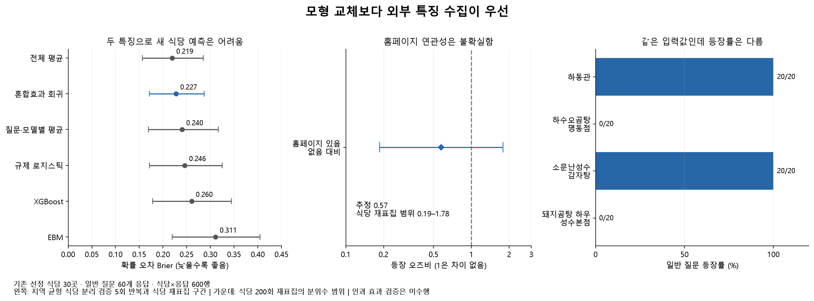

# 혼합효과 회귀·EBM·XGBoost 예비 분석 (2026-10-14)

**현재 홈페이지·메뉴군만으로는 새 식당의 추천 노출을 잘 예측하지 못했다. 알고리즘 교체보다 식당을 구분할 외부 특징 수집이 우선이다.**

## 실제 수행한 분석

- 기존에 선정한 식당 30곳을 사용했다. 162개 후보 전체를 학습한 결과가 아니다. 새 후보 대부분은 외부 특징이 미수집이라 제외했다.
- 주 분석: 일반 질문 MD01·SS01·MW01의 60개 응답, 식당×응답 600행, 언급 168행. 독립 식당 표본은 30곳이다.
- 식당 특징: 기존 조사 시점의 홈페이지 유무와 외부 메뉴 설명을 통합한 메뉴군. 질문 ID는 지역·질문 맥락을 포함하며 모델 종류도 반영했다.
- 베이지안 혼합효과 로지스틱 회귀: 식당과 응답의 무작위 절편을 포함했다. 식당 반복과 같은 응답에 속하는 관측을 반영한다.
- 초기값 변경, 사전분포 변경, 응답 절편 제거, 과거 출처 확인 표본만 사용, 조건형 질문 포함을 비교했다.
- 예측 비교: 전체 평균, 질문·모델별 평균, 규제 로지스틱, 혼합효과 회귀, EBM, XGBoost. 각 모델의 설정은 고정했고 유리한 설정·분할을 골라내지 않았다.

## 1. 새 식당 예측에서는 복잡한 모형의 이득을 확인하지 못했다

지역마다 2곳씩 총 6곳을 통째로 제외하는 5분할 검증을, 사전에 고정한 5개 난수 시드로 반복했다. 같은 식당은 훈련과 평가 양쪽에 들어가지 않는다. 3,000개 반복 평가 행은 600개 관측을 재평가한 것이며 표본이 늘어난 것이 아니다.

| 모형 | Brier 확률 오차 ↓ | 분할에 따른 표준편차 | Log loss ↓ | 전체 평균 대비 Brier 차이 | 식당 재표집 범위 |
|---|---:|---:|---:|---:|---|
| 전체 평균 | 0.219 | 0.012 | 0.638 | +0.000 | +0.000 ~ +0.000 |
| 혼합효과 회귀 | 0.227 | 0.016 | 0.655 | +0.008 | -0.004 ~ +0.021 |
| 질문·모델별 평균 | 0.240 | 0.012 | 0.709 | +0.021 | +0.003 ~ +0.043 |
| 규제 로지스틱 | 0.246 | 0.016 | 0.718 | +0.027 | -0.006 ~ +0.060 |
| XGBoost | 0.260 | 0.017 | 0.769 | +0.041 | -0.000 ~ +0.085 |
| EBM | 0.311 | 0.035 | 1.242 | +0.092 | +0.025 ~ +0.166 |

Brier는 예측 확률과 실제 0/1의 차이를 제곱해 평균한 값으로 낮을수록 좋다. 현재 설정에서는 전체 평균의 점수가 가장 낮았다. 혼합효과 회귀는 특성을 사용하는 모형 중 점수가 가장 낮았지만 평균 예측을 개선하지 못했다. 표본이 작고 범위가 넓어 모델의 보편적인 우열로 해석하지 않는다.
범위는 식당 단위로 고정된 평가 손실을 재표집한 2.5~97.5% 분위수다. 모델을 매번 다시 학습한 검증 신뢰구간이 아니며 선택 표본에 대한 탐색 자료다. 서로 다른 폴드의 확률을 섞으면 순위 지표가 영향을 받으므로 ROC-AUC·PR 지표는 폴드별 평균도 별도 저장했다.

## 2. 홈페이지의 효과를 확정하지 못했다

- 주 모형의 홈페이지 보유 오즈비 추정: **0.57**. 베이지안 평균장 근사의 95% 구간: **0.28~1.19**.
- 식당을 지역 안에서 200회 재표집한 추정치 범위: **0.19~1.78**. 차이 없는 경우에 해당하는 1을 포함한다.
- 오즈비는 확률의 배수가 아니다. 홈페이지가 추천을 줄인다는 인과 결론으로 사용하지 않는다. 홈페이지 값은 과거 조사 자료이며 현재 사이트 상태의 전수 검증은 아니다.
- 사전분포 폭을 바꾸면 홈페이지 구간이 1을 포함하는지 여부도 달라졌다. 조건형 질문을 섞은 보조 모형은 더 강한 음의 연관성을 보였지만 주 분석과 구분한다.
- 국수·만두를 기준으로 비교한 다른 메뉴군도 주 모형의 근사 구간에 차이 없는 값이 포함됐다. 인기·리뷰·가격·운영 이력 등의 미측정 특징이 남아 있다.

| 홈페이지 민감도 모형 | 오즈비 | 근사 구간 |
|---|---:|---|
| 일반 질문 주 분석 | 0.57 | 0.28 ~ 1.19 |
| 넓은 사전분포 | 0.45 | 0.20 ~ 0.98 |
| 식당 절편만 사용 | 0.58 | 0.28 ~ 1.18 |
| 과거 출처 확인 표본만 | 0.76 | 0.35 ~ 1.62 |
| 조건형 포함 보조 분석 | 0.52 | 0.39 ~ 0.70 |

모든 변분 베이지안 적합과 식당 재표집 적합은 수렴했다. 별도의 전체 공분산 Laplace 근사 점검은 수렴하지 않아 해석에서 제외하고 실패 진단을 보존했다. 변분 근사의 구간은 불확실성을 작게 평가할 수 있어 재표집 민감도와 함께 본다.

## 3. 같은 특징인데 추천 결과가 다른 사례가 핵심이다

| 지역 | 식당 | 홈페이지 조사값 | 메뉴군 | 일반 질문 등장 |
|---|---|---|---|---:|
| 명동 | 하동관 | 있음 | 국·탕·전골 | 20/20 |
| 명동 | 하수오곰탕 명동점 | 있음 | 국·탕·전골 | 0/20 |
| 성수 | 소문난성수감자탕 | 없음 | 국·탕·전골 | 20/20 |
| 성수 | 돼지곰탕 하우 성수본점 | 없음 | 국·탕·전골 | 0/20 |

각 지역의 두 가게는 현재 모형에 입력한 식당 특징이 같다. 동일 질문·모델 조건에서도 같은 입력값이 만들어진다. 식당 이름이나 과거 노출을 넣지 않는 특징 기반 모형은 이들을 다르게 예측할 근거가 없다. 명확한 메뉴군과 홈페이지만으로 실제 추천 차이를 설명하기에는 부족하다.

## 4. 같은 가게의 후속 등장에는 기존 기록이 도움이 됐다

앞선 5회로 학습하고 추가 5회로 평가했다. 같은 식당의 다음 반복을 예측하는 경우이며 새 식당 예측과는 다른 검증이다.

| 후속 측정 예측 | Brier ↓ |
|---|---:|
| 과거 등장률을 평균 쪽으로 보정 | 0.101 |
| 혼합효과 + 기존 식당의 관측 기록 | 0.072 |
| 혼합효과 + 특징만 사용 | 0.201 |

기존 식당의 관측 기록을 반영하면 후속 등장 예측이 개선됐다. 현재 수집한 특징으로 설명되지 않은 식당별 차이가 크다는 신호다. 인지도가 원인이라고 확정한 결과는 아니다. 같은 관찰일의 반복 묶음 비교이므로 다른 날짜·정보 개선 이후의 검증도 필요하다.

## 다음 분석에 필요한 데이터

1. AI 추천 여부를 보지 않고 외부 식당 목록에서 지역·메뉴군별로 추가 선정해 지속 미노출 식당을 포함한다.
2. 노출·미노출 식당 모두 같은 기준으로 Google 리뷰 수·별점·최근성, 대표 가격, 운영 이력, 관광기관·독립 가이드 소개 여부, 상호·주소 일관성을 수집한다. 수집 실패는 없음으로 바꾸지 않는다.
3. 혼합효과 회귀를 주 분석으로 유지하고, 연속형 특징이 늘어난 뒤 EBM·XGBoost를 다시 비교한다. 현재 EBM은 홈페이지 이진값과 범주형 특징만 사용해 리뷰 수의 임계점 같은 분석은 수행할 수 없었다.
4. 우선 관심 특징을 정한 뒤 일부 식당의 정보를 정비하고 비슷한 비교 식당과 같은 기간 전후 측정한다. 실제 정비나 외부 게시물 수정은 이번에 수행하지 않았다.

## 파일·재현·검수

- `run_analysis.py`: 주 모형·민감도·초기 검증·반복 묶음 검증.
- `robust_cv.py`: 지역 균형 식당 분리 검증 5회 반복. 보고서의 최종 모델 비교는 이 결과를 사용한다.
- `bootstrap_website.py`: 식당 단위 홈페이지 추정치 재표집 200회.
- `effect_estimates.csv`, `robust_model_comparison.csv`, `same_features_different_exposure.csv`: 수치와 근거.
- `environment.json`, `requirements-models.txt`: 별도 분석 환경의 실제 패키지 버전. MVP 환경은 변경하지 않았다.
- 입력 CSV 해시·평가 키·식당 분리·지역 균형·예측값·수렴·기존 소비자 자료 보존을 검수한다. 162개 후보 목록과 기존 240회 원문은 수정하지 않았다.

프로젝트 루트에서 `.venv/Scripts/python.exe`로 위 세 분석 파일과 `render_report.py`를 차례로 실행하면 재현할 수 있다. 분석 환경은 이 폴더의 `.venv`에 있다.

## 방법 근거

- [statsmodels 베이지안 이항 혼합모형](https://www.statsmodels.org/stable/generated/statsmodels.genmod.bayes_mixed_glm.BinomialBayesMixedGLM.html): 반복 관측을 위한 무작위 효과와 사용한 근사 추정 방법.
- [InterpretML EBM](https://interpret.ml/docs/ebm.html): 특징별 예측 기여를 분석하는 가법 모형.
- [SHAP의 인과 해석 주의](https://shap.readthedocs.io/en/latest/example_notebooks/overviews/Be%20careful%20when%20interpreting%20predictive%20models%20in%20search%20of%20causal%20insights.html): 예측 설명을 인과 효과로 해석할 때 필요한 가정.
