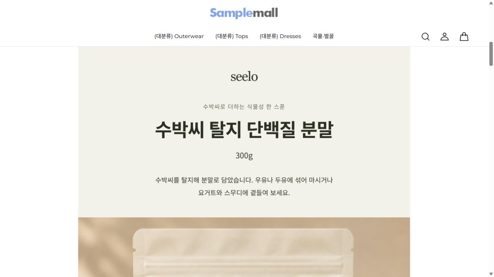
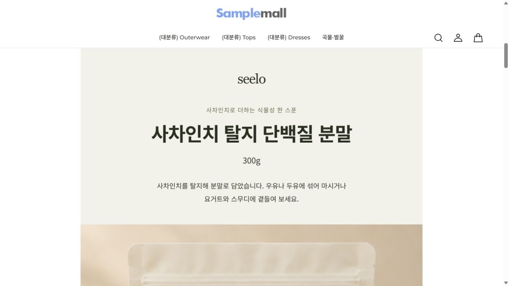

# 단백질 분말 2종 상세페이지 보완

실행일: 2026-11-23.

사용자 후속 지시인 ‘다른 것처럼 상세페이지를 만들어야지’에 따라 두 상품의 기본 문단을 기존 서리태 상품과 같은 디자인으로 교체했다. 관리자 저장 성공과 비로그인 공개 반영을 확인했다.

| 상품 | 공개 페이지 | 최종 상세 원고 |
|---|---|---|
| 수박씨 탈지 단백질 분말 300g | [상품 14](https://xodnrdl06066.cafe24.com/product/detail.html?product_no=14) | [수박씨 HTML](watermelon.html) |
| 사차인치 탈지 단백질 분말 300g | [상품 15](https://xodnrdl06066.cafe24.com/product/detail.html?product_no=15) | [사차인치 HTML](sacha.html) |

## 적용 내용

- 기존 seelo 서리태 상세의 베이지·올리브색, 글자 크기, 간격, 860px 본문 폭을 재사용했다.
- 상품 소개, 패키지 사진, 활용 사진, 우유·두유·요거트·스무디 활용법, 상품 구성, 보관 방법, 섭취 전 확인을 넣었다.
- 패키지 사진은 이미 등록된 카페24 대표사진을 사용했다. 활용 사진은 내장 image_gen으로 상품별 1장씩 생성해 카페24에 업로드했다.
- 상세 디자인을 위해 HTML을 변경했다. GEO용 FAQ·표·추가 링크·스키마·JSON-LD·숨은 텍스트는 추가하지 않았다.
- 확정되지 않은 영양 함량·원산지·인증·효능 수치는 만들지 않았다.
- 기존 SEO Title·Author·Description·Keywords·Alt·가격·구매 제한·재고관리 설정은 저장 전 비교에서 동일했다.

이미지 생성 모드는 내장 도구다. 새 사진의 최종 파일과 실제 프롬프트는 [이미지 생성 기록](이미지생성기록.json)에 보존했다. 생성 사진은 예시몰용 합성 이미지이며 실물 촬영본이 아니다.

## 검증

| 항목 | 결과 | 증거 |
|---|---|---|
| 관리자 저장 | 두 상품 모두 ‘상품이 수정되었습니다’ 확인 | [수박씨](수박씨_저장검증.json), [사차인치](사차인치_저장검증.json) |
| SEO 유지 | 공개 Title·Description·Keywords가 기존 설정과 일치 | [공개 PC 검증](공개_PC검증.json) |
| 상세 사진 | 패키지 2장·활용 2장 모두 공개 페이지에서 로드 | [공개 PC 검증](공개_PC검증.json) |
| 본문 구조 | 상품별 일반 제목·문단·사진 표시, 본문 스키마 없음 | [공개 PC 검증](공개_PC검증.json) |
| 모바일 390×844 | 두 상품 본문 표시, 페이지 폭 375px, 제목 영역 넘침 없음 | [모바일 검증](모바일검증.json) |
| 구매 제한 | 기존 제한 설정 동일, 비로그인 구매·장바구니 버튼 없음 | [모바일 검증](모바일검증.json) |

주문서 진입 차단은 최초 등록 때 검증했다. 이번에는 상세페이지를 변경했고 실제 주문·결제 또는 주문서 진입 재검사는 하지 않았다. 검색엔진 색인·AI 추천 성능도 측정하지 않았다.

플랫폼 안의 기존 상품 상세를 수정한 작업이다. 독립 웹사이트 생성용 Taste Skill 스크립트는 실행하지 않았다. 실제 카페24 공개 화면에서 PC·모바일을 검수했다.

## 화면 증거

- 활용 사진: [수박씨](수박씨_PC_활용사진_로드완료.jpg), [사차인치](사차인치_PC_활용사진.jpg).
- 모바일: [수박씨](수박씨_모바일_상세.jpg), [사차인치](사차인치_모바일_상세상단.jpg).
