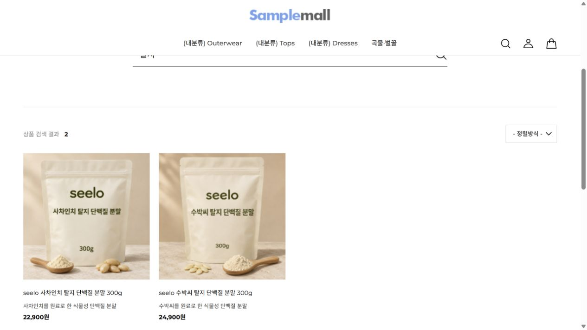

# 카페24 단백질 분말 2종 등록 및 SEO 설정

기준일: 2026-11-23

최신 후속 상태: 사용자 지시로 두 상품의 상세페이지를 기존 seelo 상품 디자인에 맞춰 보완했다. 기본 문단 고정은 최초 등록 단계의 기록이다. 현재 상세와 검증은 [상세페이지 보완 결과](상세페이지_보완/실행결과.md)를 따른다. 기존 SEO 설정과 구매 제한은 유지했다.

사용자 요청에 따라 수박씨·사차인치 탈지 단백질 분말을 추가했다. 상품 기본 등록 후 카페24 SEO 항목을 설정했다. GEO용 상세 HTML 최적화는 하지 않았다.

## 등록 상품

| 상품명 | 상품번호 | 상품코드 | 가격 | 공개 페이지 |
|---|---:|---|---:|---|
| seelo 수박씨 탈지 단백질 분말 300g | 14 | P000000O | 24,900원 | [상품 보기](https://xodnrdl06066.cafe24.com/product/detail.html?product_no=14) |
| seelo 사차인치 탈지 단백질 분말 300g | 15 | P000000P | 22,900원 | [상품 보기](https://xodnrdl06066.cafe24.com/product/detail.html?product_no=15) |

두 상품은 [탈지 검색 결과](https://xodnrdl06066.cafe24.com/product/search.html?keyword=%ED%83%88%EC%A7%80)에서 함께 볼 수 있다. 관리자 등록 수는 기존 5개에서 7개로 늘었다. 기존 상품은 수정하지 않았다.

## 변경 범위

- 기본 등록: 상품명, 300g 구성, 가격, 요약·간단 설명, 대표사진, 기본 상세 설명.
- SEO 설정: Title, Description, Keywords, 쇼핑몰 내부 검색어, 대표 이미지 Alt, Author `seelo`, 검색엔진 노출함.
- 상세 설명: 일반 `p`·`br` 문단만 입력했다. 기본 설명을 입력한 시점의 HTML을 기준으로 보존했다.
- GEO 미적용: 제목 계층, FAQ, 표, 의미 태그, 스키마, JSON-LD, 추가 링크를 삽입하지 않았다. 스킨 HTML도 변경하지 않았다.
- 영양수치: 원료사 조사값을 seelo 상품의 확정 수치로 사용하지 않았다. 제조원·원산지·소비기한·영양성분 수치는 확인 전 상태다.

SEO 전체 값과 기본 설명은 [상품구성.json](상품구성.json)에 보존했다. 대표사진 생성 방식·프롬프트·파일 경로는 [이미지 생성 기록](이미지_생성기록.md)에 기록했다.

## 검증 결과

| 검증 | 결과 | 증거 |
|---|---|---|
| 관리자 저장값 재조회 | 두 상품 SEO·검색어·Alt 일치 | [관리자 저장값](검증/관리자_저장값.json) |
| SEO 전후 상세 HTML | 두 상품 모두 동일 | [본문 비교](검증/SEO전후_본문비교.json) |
| 비로그인 공개 페이지 | Title·Description·Keywords 일치, 이미지 로드, 기본 HTML 일치 | [공개 검증](검증/공개_SEO_HTML검증.json) |
| 모바일 390×844 | 이름·가격·사진·기본 상세 확인, 가로 넘침 없음 | [모바일 검증](검증/모바일.json) |
| 구매 제한 | 일반회원 제외, 검증 전용 등급만 허용, 비회원 구매버튼 없음 | [관리자 저장값](검증/관리자_저장값.json) |
| 비로그인 AI 직접 주문 경로 | 두 상품 모두 주문 불가 경고로 차단 | [주문 차단](검증/주문차단.json) |
| AI 상품 조회 | 상품 조회 가능, `display=T`, `selling=T` | [수박씨](검증/watermelon_AI조회.json), [사차인치](검증/sacha_AI조회.json) |

재고 관리는 사용하지 않으며 품절 표시는 없다. 기존 `seelo 검증 전용` 등급 제한을 재사용했다. 실제 주문·결제는 만들지 않았다. 이번 작업에서 AI 추천 성능이나 검색엔진 색인 여부를 측정하지 않았다.

## 화면 증거

PC 상세: [수박씨](검증/watermelon_PC.jpg), [사차인치](검증/sacha_PC.jpg).

모바일 상세: [수박씨](검증/watermelon_모바일_상세.jpg), [사차인치](검증/sacha_모바일_상세.jpg).
