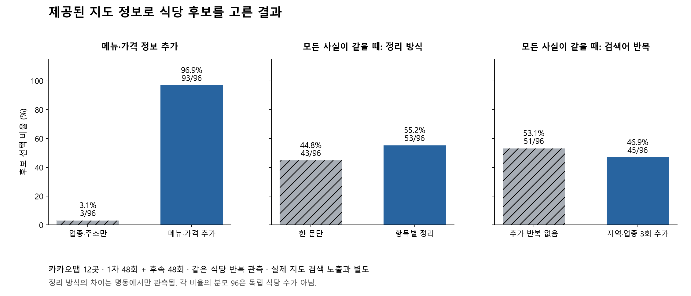

# 96회 통제 실험과 60곳 지도 정보 수집 결과

2026-10-16 기준. **카카오 지도 후보 60곳의 상세 상호·주소를 대조했고, 57곳에서 가격이 있는 메뉴 221개를 수집했다.** 별도 12곳 정보 제공 실험은 총 96회 완료했다. 실제 지도 검색 노출 효과는 아직 측정하지 못했다.

## 이번에 완료한 범위

| 자료 | 완료 범위 | 해석 |
|---|---|---|
| 자연 검색 접근 파일럿 | 기존 18셀, 정상 13건·타 사이트 기반 추천 64건·권한 실패 5건 | 변경하지 않음. CLI 지도 상세 본문 열람은 검증되지 않음 |
| 메뉴·가격 제공 비교 | 새 세션 48회, 후보 12곳 | 메뉴·가격 제공과 지역·업종 반복의 2×2 비교 |
| 동일 사실의 표현 비교 | 새 세션 48회, 같은 후보 12곳 | 불릿·줄바꿈과 한 문단, 반복 유무의 2×2 비교 |
| 향후 자연 검색 후보 | 명동 주변·성수/서울숲·망원 각 20곳, 60개 고정 장소 ID | AI 추천 여부로 고르지 않음. 기본 지도 검색 앞 20곳의 편의 표본 |
| 카카오 상세 관측 | 60곳 상호·주소 일치, 리뷰 수·별점, 요약 표시 수집 | 사진 수는 모두 `+` 표시라 정확 수치 미대입 |
| 가격 있는 텍스트 메뉴 | 57곳, 총 221개 항목 | 홈에서 보이는 가격 항목 최대 4개. 전체 메뉴·최소 식사비 아님 |
| 소개 성격의 짧은 문단 | 6곳 | 작성자 불명. 업주 소개 길이로 사용하지 않음 |
| 네이버 동일 지점 | 고정 후보 중 2곳의 업주 소개 확인 | 아직 60곳 전수 대응 아님. 구글 대응도 미완료 |

## 통제 실험에서 확인한 패턴

카카오 지도에서 수집한 정보를 익명으로 CLI에 제공한 뒤, 후보 4곳 중 2곳을 고르게 했다. **이것은 자연 검색에서 가게를 알아서 찾아낸 실험이 아니다.** 상호·리뷰·지도 순위는 제공하지 않았다.

- 1차: 메뉴·가격 정보 제공 후보 **93/96 (96.9%)**, 업종·주소만 제공 후보 **3/96 (3.1%)** 선택. 정보량·메뉴 종류·가격 수준이 함께 변한 결과다.
- 후속: 모든 메뉴·가격 사실을 같게 둔 비교에서 항목별 정리 **53/96 (55.2%)**, 한 문단 **43/96 (44.8%)**. 차이는 명동에서만 나타났고 성수·망원에서는 0이었다.
- 같은 사실 비교의 지역·업종 추가 반복: 반복 없음 **51/96 (53.1%)**, 반복 있음 **45/96 (46.9%)**. Codex에서는 차이가 0, Antigravity에서는 반복 조건의 선택률이 낮았다. 일관된 이점은 확인하지 못했다.

분모 96은 각 비교의 후보 관측 수이고 독립 식당 수는 12곳이다. 96개 응답을 새 식당 96곳으로 세지 않는다. 후속 설계는 1차 결과를 본 뒤 만든 탐색 비교다. 상세한 배정·모형·검수와 식당별 결과는 [통제 실험 보고서](./정보제공_통제실험/README.md)에 있다.

## 새 수집에서 발견한 주요 한계: 어떤 메뉴를 보여주는가

**57곳 중 23곳**은 앞의 가격 항목 2개보다 뒤의 3~4번째 항목에 더 낮은 가격이 있었다. 첫 2개 메뉴를 대표 메뉴·식사비로 쓰면 식당을 잘못 요약할 수 있다.

예를 들어 육통령 명동본점의 처음 두 항목은 48,000원·38,000원이었지만, 이어서 15,000원 비빔밥과 8,000원 김치찌개(공기밥 별도)가 표시됐다. 앞선 익명 선택 실험의 0/16을 이 식당의 일반적인 추천 가능성이나 가성비로 해석할 수 없다. [직접 확인한 지도](https://place.map.kakao.com/21748255).

다음 실험은 모든 식당에 같은 개수의 **식사 목적에 맞는 메뉴**를 주거나, 메뉴 선택 규칙 자체를 실험 요인으로 분리해야 한다. 단가·중량·인원·추가 주문 조건을 보존하고, 전체 메뉴가 확보되지 않은 상태에서 최소 식사비를 계산하지 않는다.

## 작성자 구분이 필요한 이유

60곳 모두 카카오 `kanana` 장소 요약이 보였고, 인증 매장 표시는 30곳에서 관측했다. 인증 여부는 모든 소개·메뉴 문구를 업주가 작성했다는 증거가 아니다. 요약 표시가 모든 표본에서 같으므로 이 표본만으로 요약 보유 효과도 추정할 수 없다.

홈의 짧은 소개 성격 문단은 6곳에서 관측했지만 작성자를 확인하지 못했다. 나머지 54곳도 소개가 원래 없다고 단정하지 않고 `not_observed_in_home`으로 기록했다. 사진 표시는 `999+`, `872+`처럼 모두 축약/하한 형태라 정확 사진 수로 변환하지 않았다.

네이버에서는 고정 후보 2곳을 상호·도로명 주소·층으로 대조하고 ‘업주’ 표시가 있는 소개를 펼쳐 확인했다.

- [장인닭갈비 명동점](https://m.place.naver.com/restaurant/1225449916/information): 소개 1,145자, 대괄호 구분 3개. 상호 반복 9회와 재료·리필·단체 이용 관련 설명을 관측했다.
- [명동피자 명동본점](https://m.place.naver.com/restaurant/32247873/information): 소개 460자, 하이픈 구분 22개. 지역·이용 상황·숙성 시간·인원 설명을 관측했다. 다른 식당 상호도 포함돼 있어 **출처에 상호가 나온 것과 AI가 추천한 것을 구분**해야 한다.

두 소개 모두 본문 안 숫자+원 가격은 관측되지 않았다. 별도 메뉴 가격이 없다는 뜻은 아니다. 글 길이·반복 횟수와 실제 노출의 관계는 이 두 사례로 추정하지 않는다. 소개에 적힌 원산지·수상·수용 인원 등은 가게의 주장으로 보존하며 별도로 사실 인증하지 않았다.

## 결측 처리와 다음 분석

가격 미관측 3곳은 다음처럼 구분했다. 다른 사이트 가격이나 유사 지점 가격으로 채우지 않았다.

| 후보 | 관측 상태 |
|---|---|
| 르메르디앙 서울명동 라팔레트파리 | 홈의 메뉴 텍스트를 확보하지 못함. 추가 점검에 로딩 표시도 있어 메뉴 없음으로 코딩하지 않음 |
| 도돗 | 홈과 메뉴 탭 초기 상태에서 가격 텍스트 미확보. 원래 메뉴가 없다는 뜻은 아님 |
| 힛사츠와자 | 메뉴 탭에서 메뉴명과 메뉴판 이미지는 보였지만 텍스트 가격 미확보 |

이번 60곳 특징에는 **자연 검색 노출 라벨을 아직 붙이지 않았다.** 접근이 검증되지 않은 기존 추천이나 12곳 선택 실험을 60곳에 역으로 결합하지 않는다. 우선 네이버·구글 동일 지점 연결, 업주 소개 원문과 작성 특징, 브랜드 묶음 검수를 보강해야 한다. CLI 실제 지도 본문 접근이 확보되면 새 자연 검색 결과를 수집한다.

실제 작성 방식과 반복 노출 자료가 쌓인 뒤 규제/혼합효과 회귀로 관계를 보고, 독립 식당/브랜드·날짜로 분리한 XGBoost 예측 비교를 보조로 사용한다. 지금 12곳 실험에 XGBoost를 적용하지 않았다.

## 파일

- [60곳 정규화 특징](./kakao_features_60.csv), [메뉴 221개](./kakao_menu_items_60.csv), [필드별 근거](./kakao_field_observations_60.csv)
- [원 관측 JSON](./kakao_60_capture.json), [수집 검수](./kakao_60_validation.json), [메뉴 선택 민감도](./menu_capture_sensitivity.csv)
- [네이버 업주 소개 대응](./naver_owner_matches.json), [고정 후보](./candidate_frame.csv)
- [통제 실험 96회 결과](./정보제공_통제실험/README.md), [통합 검수](./followup_validation.json)

원문 전체 DOM·장문 소개 전문은 이번 파일에 보존하지 않았다. 짧은 인용, 관측 시각, 출처와 구조화 수치를 보존했으며, 본 분석용 텍스트 특징은 전문을 다시 고정 수집해 검수해야 한다. 메뉴·소개 원문이 미래에 바뀌었을 때 현재 파일만으로 전체 화면을 복원할 수는 없다.
