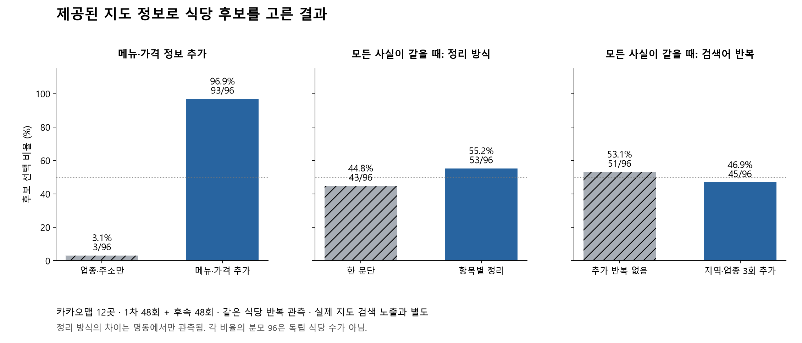

# 지도 정보 제공 실험: 96회 결과

2026-10-16. **제공한 후보 중에서는 구체적인 메뉴·가격이 있는 정보가 선택에 크게 작용했다. 같은 정보를 썼을 때 항목별 정리는 일부 지역에서만 차이가 났고, 지역·업종 반복의 일관된 이점은 확인하지 못했다.**

이 결과는 **실제 지도에서 식당을 발견하는 노출 실험과 별개**다. CLI의 지도 상세 본문 접근 문제를 해결한 결과가 아니다. 연구자가 브라우저에서 수집한 카카오맵 정보를 프롬프트에 제공하고 후보 중 선택을 비교했다. 네이버·구글 효과와 소비자용 ChatGPT·Gemini 효과는 측정하지 않았다.

## 실행 범위

- 카카오맵 `명동 식당`, `성수 식당`, `망원 식당`의 최초 4개 식당씩 **12곳**, AI 추천 여부를 사용하지 않고 선정했다. 각 상세 페이지에서 상호·주소와 표시된 첫 메뉴 2개·가격을 확인했다.
- 실제 상호, 리뷰, 평점, 사진, 지도 순위, URL을 모델에게 주지 않았다. 메뉴·주소로 상호를 알아볼 가능성까지 완전히 제거한 것은 아니다. 메뉴 필드 작성자는 확인되지 않아 `unknown`으로 보존했다.
- 지역별 후보 4곳 중 2곳을 선택하도록 했다. 각 식당이 4개 조건에 모두 배정되게 하고, 조건과 표시 위치도 균형을 맞췄다. 두 모델에 같은 질문을 새 세션으로 제공했다.
- **1차 48회 + 후속 48회 = 정상 응답 96회**, 후보×응답 384행·선택 192건. 독립 식당은 계속 12곳이다. 각 실험에서 같은 식당은 16번 관측됐다.
- Codex 요청 모델 `gpt-6.1-sol`, Antigravity `Gemini 3.8 Flash (Low)`·관측 CLI 버전 `1.4.0`. Codex의 실제 모델 식별자는 스트림에서 별도로 보고되지 않았다.
- 96회 모두 외부 도구 호출 없이 완료했고, 선택 근거로 인용한 문구가 제공한 카드에 존재했다. 이는 인용 일치 검수이며, 모든 선정 이유의 추론을 사실로 검증했다는 뜻은 아니다.

## 1차: 메뉴·가격 정보가 있으면 더 선택되나

사전계획을 고정한 뒤 메뉴·가격 제공 여부와 지역·업종 3회 추가 반복을 교차했다. 기본 조건은 업종·지역·주소, 보강 조건에는 실제 지도에서 표시된 첫 메뉴 2개와 가격을 추가했다. 4개 후보 중 항상 2개가 보강 조건이었다.

| 비교 | Codex | Gemini / Antigravity | 합계 |
|---|---:|---:|---:|
| 메뉴·가격 미제공 | 2/48 (4.2%) | 1/48 (2.1%) | **3/96 (3.1%)** |
| 메뉴·가격 제공 | 46/48 (95.8%) | 47/48 (97.9%) | **93/96 (96.9%)** |
| 추가 반복 없음 | 24/48 (50.0%) | 23/48 (47.9%) | 47/96 (49.0%) |
| 지역·업종 3회 추가 반복 | 24/48 (50.0%) | 25/48 (52.1%) | 49/96 (51.0%) |

정보 보강에 따른 관측 차이는 **+93.8%p**였다. 반복만의 차이는 +2.1%p였다. 미보강 조건에서 선택된 예외 3건은 모두 망원돈까스 본점에 해당하는 가명 후보였다.

단, **정보량·메뉴 종류·가격 수준·문자 수가 함께 바뀐 비교**다. 가격 표기만의 순수 효과가 아니다. 제공 정보만 사용하라는 질문과 4개 중 2개를 고르는 구성이 정보 보강 선호를 크게 만들 수 있다. 실제 지도에 메뉴를 추가하면 노출이 93.8%p 오른다고 해석할 수 없다.

## 후속: 모든 사실을 같게 두고 표현만 바꾸면

1차 결과를 본 뒤 동일한 12곳으로 후속 설계를 고정하고 새로 48회 실행했다. 모든 후보에 같은 메뉴·가격을 제공했다. ‘항목별 목록/한 문단’과 ‘지역·업종 추가 반복 유무’를 교차했다. 목록과 문단은 불릿·공백·줄바꿈 외에 내용이 동일한지 검수했다. 별도 독립 표본을 이용한 확증 실험은 아니다.

| 비교 | Codex | Gemini / Antigravity | 합계 |
|---|---:|---:|---:|
| 한 문단 | 22/48 (45.8%) | 21/48 (43.8%) | **43/96 (44.8%)** |
| 항목별 정리 | 26/48 (54.2%) | 27/48 (56.3%) | **53/96 (55.2%)** |
| 추가 반복 없음 | 24/48 (50.0%) | 27/48 (56.3%) | **51/96 (53.1%)** |
| 지역·업종 3회 추가 반복 | 24/48 (50.0%) | 21/48 (43.8%) | **45/96 (46.9%)** |

항목별 정리는 전체 +10.4%p였지만, **명동에서만 +31.3%p**, 성수·망원에서는 차이가 0이었다. 추가 반복은 명동 -18.8%p, 나머지 두 지역 0이었다. 문서 정리가 항상 유리하다거나 반복이 항상 불리하다고 일반화할 수 없다.

## 어떤 식당이 선택됐나

아래는 **모든 메뉴·가격을 제공한 후속 실험**의 결과다. 각 지역의 고정 후보 4곳끼리 경쟁했으며, 실제 상호는 모델에 주지 않았다. 자연 검색에서 이 식당을 알아서 찾은 횟수가 아니다.

| 지역 | 식당 | 선택/제시 |
|---|---|---:|
| 명동 주변 | 반포식스 서울시청점 | 13/16 |
| 명동 주변 | 명동피자 명동본점 | 11/16 |
| 명동 주변 | 장인닭갈비 명동점 | 8/16 |
| 명동 주변 | 육통령 명동본점 | 0/16 |
| 성수·서울숲 | 빠오즈푸 서울숲점 | 16/16 |
| 성수·서울숲 | 오레노카츠 성수본점 | 14/16 |
| 성수·서울숲 | 차만다 성수 | 2/16 |
| 성수·서울숲 | 눈꽃돼지 | 0/16 |
| 망원 | 망원돈까스 본점 | 16/16 |
| 망원 | 정각 서울망원본점 | 14/16 |
| 망원 | 퍼줄래대박집 | 2/16 |
| 망원 | 산이네회무침 | 0/16 |

모델은 팟타이·비프누들, 돈까스 정식, 된장찌개처럼 제공된 메뉴를 한 끼 식사로 설명했다. 이 이유는 모델의 자기 설명이다. 가격이 낮아서 선택됐다는 독립 원인까지 분리한 것은 아니다. 표시는 해당 메뉴 항목의 가격이며 1인 식사 총액·최소 주문 조건을 확인한 값이 아니다. 첫 2개 메뉴에는 사이드·고가·단체 요리도 포함되므로 대표성 한계가 있다.

## 분석 방법과 검수

주 분석은 모델별 2×2 선택률과 같은 식당 안의 조건 차이다. 1차 보조 모형은 **4개 중 2개 선택의 여섯 조합을 직접 다루는 규제 조건부 선택 모형**으로 식당·위치를 반영했다. 두 모델 모두 수렴했지만 예측 성능 검증이나 외부 지도 노출 계수로 사용하지 않았다.

1차 보조 무작위화 검정은 6개의 지역×반복 배정 블록을 단위로 했다. 메뉴·가격 정보 제공의 양측 p=0.03125, 두 요인 Holm 보정 p=0.0625였다. 이 추론 방법은 수집 시작 후 결과 검토 전에 정한 보조 분석이다. 192개의 후보 행을 독립 표본으로 간주한 검정이 아니며, 모집단의 확증 근거로 쓰지 않는다. 후속 비교는 기술 통계로 보고했다.

**XGBoost는 학습하지 않았다.** 96회 답변을 식당 96곳으로 세면 안 된다. 현재는 같은 식당·같은 후보 집합을 교차 비교하는 설계가 복잡한 예측 모형보다 연구 질문에 직접 맞는다.

다음 특징 수집에서도 메뉴·가격 표시, 단위/주문 조건, 방문 정보, 업주 소개, 플랫폼 AI 요약을 분리한다. 이번에 직접 비교한 것은 메뉴·가격 제공, 불릿·줄바꿈, 지역·업종 추가 반복이다. 주차·영업시간·업주 소개의 원래 문체 효과를 검증한 것은 아니다.

## 다음 표본과 남은 작업

향후 자연 검색 측정을 위한 카카오 지도 후보를 **지역별 20곳, 총 60곳**으로 고정했다. AI 답변으로 고르지 않고 기본 검색의 앞 20개 장소를 사용했다. [후보표](../candidate_frame.csv), [고정 근거와 해시](../candidate_frame_freeze.json).

후속 수집을 이어가 **60곳 모두 카카오 상세 상호·주소를 대조**했고, 57곳에서 가격 있는 메뉴 221개를 수집했다. 가격 미확보 3곳은 결측 사유를 분리했다. 추가로 네이버 동일 지점 2곳의 업주 소개를 확인했다. 네이버·구글 전수 연결, 브랜드 그룹 검수, 업주 소개 원문 전수 수집은 남아 있다. 60곳은 이번 12곳 실험을 거꾸로 평가하는 표본으로 사용하지 않는다. [60곳 수집·검수 결과](../수집_검수_후속결과.md).

특히 57곳 중 23곳에서 처음 2개보다 뒤의 3~4번째 가격 항목에 더 낮은 가격이 있었다. 육통령 명동본점도 첫 두 항목 뒤에 8,000원 김치찌개(공기밥 별도)와 15,000원 비빔밥이 표시됐다. 위 0/16은 제공된 두 메뉴 조건의 선택이며 식당 전체의 일반 추천 가능성으로 해석하지 않는다.

CLI가 지도 상세 본문을 직접 읽는 경로는 여전히 확보하지 못했다. 따라서 계획된 자연 검색 본 측정 90회는 미실행 상태다. 이번 통제 실험과 합산하지 않는다.

## 재현 파일

- 입력·설계: `사전계획.md`, `selected_profiles.json`, `captured_menu_facts.json`, `corpus.json`, `design_freeze.json`, `assignments.json`, `prompts.json`, `run_manifest.csv`
- 1차 원문·전처리: `attempts.jsonl`, `raw/`, `candidate_outcomes.csv`, `condition_summary.csv`, `factor_effects.csv`, `within_store_deltas.csv`, `validation.json`
- 보조 분석: `analysis_protocol.json`, `randomization_tests.json`, `conditional_choice_ridge.json`
- 후속: `동일정보_표현비교/`의 같은 형식 파일. 원문과 결과는 별도로 유지함
- 프로그램: `run_controlled.py`, `analyze_controlled.py`, `render_comparison.py`, `동일정보_표현비교/run_equal_facts.py`, `동일정보_표현비교/analyze_equal_facts.py`

두 실험의 96셀 누락·중복 없음, 입력 해시 일치, 384개 후보 관측·192개 선택, 외부 도구 호출 없음, 인용 일치, 동일 정보 비교 검수를 통과했다. 이전 자연 검색 18셀 원문·기존 소비자 결과/실패 파일도 원래 해시와 일치했다. 새 결과를 과거 240회 자료에 합산하지 않았다.
